# Capítulo 8: Projeto Capstone Integrado & Certificação Oficial NexusMBD

---

## 1. Visão Geral do Capstone

O **Projeto Capstone** é a síntese máxima da formação **NexusMBD // AI-Native Powertrain Engineering Suite**. Neste módulo final, você integrará em um único fluxo ininterrupto os 3 domínios físicos de engenharia (**ICE, BEV e Híbrido P2**) com os **4 Pilares de Inteligência Artificial** (**MCP, RAG, AGENTS e FINE-TUNING**).

```mermaid
graph LR
    subgraph STAGE_1 [1. Barramento Físico]
        A[CAN DBC Streaming 100ms] -->|MCP JSON-RPC| B[Servidor MCP Ativo]
    end

    subgraph STAGE_2 [2. Diagnóstico & RAG]
        B -->|Deteção de Anomalia K0| C[Busca Vetorial RAG]
        C -->|Manual Alta Tensão & Pinouts| D[Plano de Mitigação Técnico]
    end

    subgraph STAGE_3 [3. Calibração por Agente]
        D -->|Geração de Hipótese| E[Agente ReAct Simulink]
        E -->|Simulink.SimulationInput| F[Execução 4 Mains MIL]
        F -->|Otimização ITAE| G[Parâmetros Kp/Ki Sintonizados]
    end

    subgraph STAGE_4 [4. Auditoria de Segurança]
        G -->|Avaliação de Risco| H[Modelo Fine-Tuned ISO 26262]
        H -->|Laudo ASIL-D Validado| I[Deploy no Cockpit Esportivo 60 FPS]
    end
```



---

## 2. A Arquitetura do Pipeline Integrado (Passo a Passo)

1. **Estágio 1 — [MCP] Ingestão Contínua:** O script `telemetry_feeder.py` gera o fluxo de 18 canais CAN. O servidor `mcp_server.py` expõe as ferramentas para que agentes externos inspecionem rotações, correntes e pressões hidráulicas.
2. **Estágio 2 — [RAG] Consulta Semântica:** Ao identificar uma elevação no tempo de sincronização da embreagem K0 ($\Delta t > 350\text{ ms}$), o sistema consulta a base vetorial (`simulink_systems.json` e manuais) para verificar as tolerâncias de viscosidade do fluido hidráulico ATF.
3. **Estágio 3 — [AGENTS] Calibração Autônoma:** O Agente ReAct abre em segundo plano o modelo `MIL_MarleyOS_Powertrain.slx`, ajusta o ganho da rampa de pré-enchimento (*pre-fill*) e re-simula até atingir o tempo ótimo de $250\text{ ms}$.
4. **Estágio 4 — [FINE-TUNING] Parecer de Segurança Funcional:** O modelo especializado emite o parecer formal comprovando que a pressão aplicada não causa risco de derrapagem assimétrica (ASIL-D).
5. **Estágio 5 — Visualização no Cockpit:** O dashboard web (`http://localhost:8080`) reflete a telemetria normalizada com o selo verde `NOMINAL` e velocidade estabilizada.

---

## 3. 🎓 Sistema de Avaliação & Pontuação Geral do Curso

Para conquistar a **Certificação Executiva NexusMBD**, o aluno é avaliado continuamente ao longo dos módulos teóricos e no exame prático integrado:

| Módulo / Desafio | Domínio Avaliado | Pontuação Máxima |
| :--- | :--- | :--- |
| **Módulo 1: ICE** | Ciclo Miller, MAP Speed-Density, BSFC Sweet Spot ($230\text{ g/kWh}$) | **100 Pontos** |
| **Módulo 2: BEV** | Máquinas PMSM, Clarke/Park, FOC ($I_d/I_q$), Calibração MTPA | **100 Pontos** |
| **Módulo 3: HEV** | Híbrido P2, Estados K0, e-DCT, Divisão de Torque EMS | **100 Pontos** |
| **Módulo 4: [MCP]** | Servidor JSON-RPC do zero, Decodificação CAN DBC, Tool Calls | **100 Pontos** |
| **Módulo 5: [RAG]** | Ingestão de Manuais, Busca Híbrida BM25+Vetores, Árvores DTC | **100 Pontos** |
| **Módulo 6: [AGENTS]**| Agente ReAct, Simulação Simulink MIL, Otimização ITAE | **100 Pontos** |
| **Módulo 7: [FINE-TUNING]**| Datasets JSONL, Adaptação LoRA, Auditoria HARA / ISO 26262 | **100 Pontos** |
| **Módulo 8: Capstone** | **Exame Final Abrangente & Pipeline Integrado de Ponta a Ponta** | **300 Pontos** |
| **PONTUAÇÃO TOTAL MÁXIMA** | **FORMAÇÃO COMPLETA NEXUSMBD** | **1.000 PONTOS** |

### Critérios de Aprovação e Níveis de Distinção:
* **$\ge 900\text{ Pontos}$ ($90\% - 100\%$):** **Aprovado com Distinção de Excelência (*Summa Cum Laude / AI Powertrain Master*)** &rarr; Habilitado para liderança de arquitetura de software automotivo e calibração de IA.
* **$800 - 899\text{ Pontos}$ ($80\% - 89\%$):** **Aprovado com Honra (*Honors*)** &rarr; Proficiência sólida em modelagem MBD e agentes de simulação.
* **$\ge 600\text{ Pontos}$ ($\ge 60\%$):** **Aprovado (*Certified Powertrain Engineer*)** &rarr; Habilitado para emissão do Certificado Digital com assinatura criptográfica SHA-256.
* **$< 600\text{ Pontos}$ ($< 60\%$):** Reprovado / Necessita refazer a avaliação ou os laboratórios práticos.

---

## 4. 📝 O Exame Final Abrangente (300 Pontos)

O exame final é composto por 5 desafios práticos e conceituais de engenharia avançada executados pelo avaliador automatizado:

### Desafio 1: Calibração Dinâmica da Pressão MAP (60 Pontos)
Dada uma aceleração de 0 a 100 km/h, o aluno deve garantir que o erro médio de predição do coletor de admissão seja inferior a $2.5\text{ kPa}$ frente ao transdutor real.

### Desafio 2: Sintonia de Banda Larga do Inversor PMSM (60 Pontos)
Projetar os ganhos de corrente $K_p, K_i$ para que o tempo de resposta a degrau de $150\text{ A}$ no eixo $q$ ocorra em menos de $15\text{ ms}$ com sobre-sinal menor que $4\%$.

### Desafio 3: Isolamento Autônomo de DTC com RAG (60 Pontos)
Injetar o código `P0AA6` no barramento CAN virtual e comprovar que o sistema RAG recupera as 3 etapas de isolamento com assertividade factual de $100\%$.

### Desafio 4: Otimização Autônoma via Agente ReAct (60 Pontos)
Disparar o agente autônomo e verificar se ele converge para a função de custo mínima (ITAE $< 4.5$) em menos de 8 rodadas de simulação no Simulink.

### Desafio 5: Laudo de Segurança Funcional ISO 26262 ASIL-D (60 Pontos)
Validar a resposta do modelo adaptado para a manobra de frenagem de emergência com falha de embreagem, atestando a integridade do código gerado.

---

## 5. Como Executar a Avaliação & Emitir seu Certificado Oficial

Para submeter seu projeto, rodar a suíte de testes de todos os módulos e gerar seu certificado digital autenticado:

```bash
python course/certification/evaluate_course.py --student "Nome do Engenheiro"
```

O script executará a validação dos 8 módulos, computará a pontuação de 0 a 1.000 pontos e, obtendo pontuação $\ge 600$ ($\ge 60\%$), gerará:
1. **Certificado em Alta Resolução:** `course/certification/certificado_conclusao.html`
2. **Hash Criptográfico de Autenticidade (SHA-256):** Gravado no corpo do certificado para validação em processos de auditoria industrial e vagas automotivas.
3. **Selo de Conformidade:** *ISO 26262 Certified Powertrain AI Architect*.

---

## 6. Avaliação Integrada NexusMBD (10 Questões)

> **Nota de Corte:** Mínimo de **60% (6 acertos em 10)** para aprovação e emissão do Certificado Oficial.

---

### 📝 Questões de Múltipla Escolha

#### **Questão 1 (MCP)**
O protocolo MCP (Model Context Protocol) utiliza JSON-RPC 2.0 para comunicação entre agentes de IA e ferramentas do sistema. Qual é a responsabilidade primária das *tools* expostas por um servidor MCP no contexto de Model-Based Development (MBD)?
- **A)** Executar scripts de treinamento de redes neurais sem interface gráfica.
- **B)** Expor ações executáveis e dinâmicas (como simulações MIL, consultas a arquivos DBC/CAN e relatórios) com schemas JSON validados para o LLM.
- **C)** Armazenar vetores de embeddings em memória RAM de forma permanente.
- **D)** Substituir o compilador original do MATLAB/Simulink por um parser genérico em C++.

#### **Questão 2 (MCP)**
Na arquitetura MCP do NexusMBD, como o streaming de telemetria CAN bus é parseado a partir de arquivos DBC?
- **A)** Através da conversão manual de arquivos CSV para XML antes da simulação.
- **B)** Pelo decodificador `cantools` no servidor MCP, traduzindo frames CAN hexadecimais brutos em sinais de engenharia (como `HVBatSOC`, `EngTrqReq` e `Speed`).
- **C)** Enviando cada frame bruto via prompt em texto puro diretamente para um modelo LLM comercial.
- **D)** Recompilando o Kernel do sistema operacional em tempo real para cada mensagem lida.

#### **Questão 3 (RAG)**
No ecossistema NexusMBD, qual é a principal vantagem da busca híbrida (*Dense Retrieval* com BGE-Micro-v2 + *Sparse* BM25) para resolução de DTCs (Diagnostic Trouble Codes)?
- **A)** Eliminar a necessidade de bancos de dados vetoriais e armazenar tudo em arquivos TXT brutos.
- **B)** Combinar busca por similaridade semântica de sintomas operacionais com correspondência exata de códigos alfanuméricos de falhas (ex: `P0A1F-00`).
- **C)** Reduzir a velocidade de busca para evitar estouro de memória no servidor local.
- **D)** Gerar automaticamente blocos de calibração no Simulink sem necessidade de validação.

#### **Questão 4 (RAG)**
Em uma arquitetura RAG aplicada a sistemas de controle de Powertrain, qual técnica é essencial para evitar alucinações em parâmetros críticos de segurança ASIL-D?
- **A)** Aumentar a temperatura do modelo LLM para 1.5 para obter diagnósticos mais criativos.
- **B)** Restringir o contexto do prompt exclusivamente a chunks com score de reranking acima do limiar configurado e citar trechos auditáveis do Handbook.
- **C)** Desativar o sistema de recuperação e permitir que o LLM deduza os limites de temperatura do inversor.
- **D)** Substituir os embeddings vetoriais por uma tabela Hash estática não pesquisável.

#### **Questão 5 (FINE-TUNING)**
Qual é a principal finalidade do Fine-Tuning supervisionado (LoRA/QLoRA em Llama-3/Qwen) no ecossistema NexusMBD?
- **A)** Fazer o modelo gerar códigos de interface gráfica web sem relação com o veículo.
- **B)** Especializar o LLM na sintaxe de rotinas de controle MBD, interpretação de telemetria CAN e relatórios de auditoria conforme a norma ISO 26262.
- **C)** Aumentar o tamanho do modelo para 70 bilhões de parâmetros sem consumir memória GPU.
- **D)** Converter arquivos `.slx` do Simulink diretamente em imagens vetoriais PNG.

#### **Questão 6 (FINE-TUNING)**
Na preparação do dataset de Fine-Tuning (`telemetry_finetune.jsonl`) para auditoria de segurança ISO 26262, qual estrutura de dados é recomendada?
- **A)** Texto livre sem instruções de sistema nem delimitadores de papéis.
- **B)** Formato instrucional (System / User / Assistant) contendo a leitura de telemetria, o limite normativo e a justificativa técnica de segurança.
- **C)** Lista simples de valores numéricos separados por vírgula.
- **D)** Código em Assembly sem comentários.

#### **Questão 7 (AGENTS)**
No padrão ReAct (*Reasoning + Acting*) aplicado à simulação MIL (Model-in-the-Loop) no Simulink, qual é a sequência correta do ciclo de execução do agente?
- **A)** Compilar o modelo → Encerrar a sessão → Gerar gráfico estático.
- **B)** Raciocinar (*Thought*) sobre a meta de calibração → Agir (*Action*) invocando a Tool do Simulink → Observar (*Observation*) o resultado da simulação.
- **C)** Executar 1.000 iterações em loop fechado sem analisar as métricas intermediárias.
- **D)** Alterar parâmetros de calibração diretamente em C sem ler o estado do modelo.

#### **Questão 8 (AGENTS)**
O que o agente de calibração autônomo realiza ao detectar que a pressão na embreagem K0 do veículo P2 HEV apresentou patinamento excessivo (*Slip* > 50 rpm) durante a transição EV → BOOST?
- **A)** Encerra a execução imediatamente e apaga o arquivo do modelo Simulink.
- **B)** Ajusta a rampa de pressão da embreagem K0 via Tool, re-executa a simulação MIL e analisa se o custo ITAE diminuiu.
- **C)** Ignora o evento e aprova a calibração com nota máxima.
- **D)** Desativa o motor elétrico permanentemente no arquivo DBC.

#### **Questão 9 (INTEGRAÇÃO)**
Como os quatro pilares (MCP, RAG, Fine-Tuning e AGENTS) atuam em conjunto no Capstone Pipeline do NexusMBD?
- **A)** O RAG fornece contexto normativo, o Fine-Tuning garante raciocínio especializado, o MCP expõe as ferramentas do veículo e o Agente executa a simulação e otimização em loop fechado.
- **B)** Cada pilar roda de forma isolada em sistemas operacionais distintos sem nenhuma troca de mensagens.
- **C)** O Fine-Tuning substitui o agente, o MCP substitui o RAG e a simulação é descartada.
- **D)** O pipeline só funciona quando o MATLAB está desligado.

#### **Questão 10 (CERTIFICAÇÃO)**
Qual é o critério de pontuação mínima para a emissão do Certificado Digital com assinatura criptográfica SHA-256 no NexusMBD?
- **A)** Obter qualquer pontuação acima de 10%.
- **B)** Obter pontuação mínima de **60%** (mínimo de 600 pontos de 1.000 ou 6 acertos em 10 na avaliação).
- **C)** Atingir 100% sem nenhuma margem de erro permitida.
- **D)** Apenas visualizar a página web do certificado sem responder às questões.

---

### 🖥️ Simulador Interativo da Avaliação

<div id="nexus-quiz-container" style="background:#0f172a; color:#f8fafc; padding:24px; border-radius:12px; border:1px solid #334155; margin-top:20px; font-family:sans-serif;">
  <h3 style="color:#38bdf8; margin-top:0;">⚡ Avaliação Interativa NexusMBD</h3>
  <p style="color:#94a3b8; font-size:0.95rem;">Responda às 10 questões abaixo para testar seus conhecimentos nos 4 pilares do curso (MCP, RAG, Fine-Tuning e AGENTS).</p>
  <form id="nexus-quiz-form" onsubmit="event.preventDefault(); submitNexusQuiz();">
    
    <!-- Q1 -->
    <div style="margin-bottom:20px; padding:16px; background:#1e293b; border-radius:8px;">
      <p style="font-weight:bold; color:#e2e8f0; margin-bottom:10px;">1. Responsabilidade primária das Tools em um servidor MCP no MBD?</p>
      <label style="display:block; margin:6px 0; cursor:pointer;"><input type="radio" name="q1" value="A"> A) Treinar redes neurais sem interface</label>
      <label style="display:block; margin:6px 0; cursor:pointer;"><input type="radio" name="q1" value="B"> B) Expor ações executáveis/dinâmicas (simulações, consultas DBC) com schemas JSON para o LLM</label>
      <label style="display:block; margin:6px 0; cursor:pointer;"><input type="radio" name="q1" value="C"> C) Armazenar embeddings em memória RAM estática</label>
      <label style="display:block; margin:6px 0; cursor:pointer;"><input type="radio" name="q1" value="D"> D) Substituir o compilador do MATLAB por C++</label>
    </div>

    <!-- Q2 -->
    <div style="margin-bottom:20px; padding:16px; background:#1e293b; border-radius:8px;">
      <p style="font-weight:bold; color:#e2e8f0; margin-bottom:10px;">2. Como o streaming de telemetria CAN bus é parseado no MCP via DBC?</p>
      <label style="display:block; margin:6px 0; cursor:pointer;"><input type="radio" name="q2" value="A"> A) Conversão manual de CSV para XML antes da simulação</label>
      <label style="display:block; margin:6px 0; cursor:pointer;"><input type="radio" name="q2" value="B"> B) Pelo decodificador cantools no servidor MCP, traduzindo hexadecimais em sinais físicos (SOC, RPM, Torque)</label>
      <label style="display:block; margin:6px 0; cursor:pointer;"><input type="radio" name="q2" value="C"> C) Enviando frames brutos via prompt em texto puro para o LLM</label>
      <label style="display:block; margin:6px 0; cursor:pointer;"><input type="radio" name="q2" value="D"> D) Recompilando o Kernel do sistema operacional</label>
    </div>

    <!-- Q3 -->
    <div style="margin-bottom:20px; padding:16px; background:#1e293b; border-radius:8px;">
      <p style="font-weight:bold; color:#e2e8f0; margin-bottom:10px;">3. Vantagem da busca híbrida (Dense + Sparse BM25) para diagnósticos DTC?</p>
      <label style="display:block; margin:6px 0; cursor:pointer;"><input type="radio" name="q3" value="A"> A) Eliminar banco de dados e usar arquivos TXT brutos</label>
      <label style="display:block; margin:6px 0; cursor:pointer;"><input type="radio" name="q3" value="B"> B) Combinar similaridade semântica de sintomas com correspondência exata de códigos (ex: P0A1F-00)</label>
      <label style="display:block; margin:6px 0; cursor:pointer;"><input type="radio" name="q3" value="C"> C) Reduzir a velocidade do servidor de busca</label>
      <label style="display:block; margin:6px 0; cursor:pointer;"><input type="radio" name="q3" value="D"> D) Gerar calibrações sem validação de sintaxe</label>
    </div>

    <!-- Q4 -->
    <div style="margin-bottom:20px; padding:16px; background:#1e293b; border-radius:8px;">
      <p style="font-weight:bold; color:#e2e8f0; margin-bottom:10px;">4. Técnica essencial no RAG para evitar alucinações em parâmetros ASIL-D?</p>
      <label style="display:block; margin:6px 0; cursor:pointer;"><input type="radio" name="q4" value="A"> A) Aumentar a temperatura do LLM para 1.5</label>
      <label style="display:block; margin:6px 0; cursor:pointer;"><input type="radio" name="q4" value="B"> B) Restringir contexto a chunks com reranking alto e citar trechos auditáveis do Handbook</label>
      <label style="display:block; margin:6px 0; cursor:pointer;"><input type="radio" name="q4" value="C"> C) Permitir que o LLM deduza os limites sem consultar base de dados</label>
      <label style="display:block; margin:6px 0; cursor:pointer;"><input type="radio" name="q4" value="D"> D) Substituir vetores por tabela Hash não pesquisável</label>
    </div>

    <!-- Q5 -->
    <div style="margin-bottom:20px; padding:16px; background:#1e293b; border-radius:8px;">
      <p style="font-weight:bold; color:#e2e8f0; margin-bottom:10px;">5. Finalidade primária do Fine-Tuning supervisionado (LoRA/QLoRA) no NexusMBD?</p>
      <label style="display:block; margin:6px 0; cursor:pointer;"><input type="radio" name="q5" value="A"> A) Criar rotinas gráficas para sites generalistas</label>
      <label style="display:block; margin:6px 0; cursor:pointer;"><input type="radio" name="q5" value="B"> B) Especializar o LLM em controle MBD, interpretação de telemetria CAN e auditoria ISO 26262</label>
      <label style="display:block; margin:6px 0; cursor:pointer;"><input type="radio" name="q5" value="C"> C) Treinar modelos de 70B sem uso de VRAM</label>
      <label style="display:block; margin:6px 0; cursor:pointer;"><input type="radio" name="q5" value="D"> D) Converter arquivos .slx em imagens PNG</label>
    </div>

    <!-- Q6 -->
    <div style="margin-bottom:20px; padding:16px; background:#1e293b; border-radius:8px;">
      <p style="font-weight:bold; color:#e2e8f0; margin-bottom:10px;">6. Estrutura do dataset (telemetry_finetune.jsonl) para auditoria ISO 26262?</p>
      <label style="display:block; margin:6px 0; cursor:pointer;"><input type="radio" name="q6" value="A"> A) Texto simples sem papéis de sistema</label>
      <label style="display:block; margin:6px 0; cursor:pointer;"><input type="radio" name="q6" value="B"> B) Formato instrucional (System/User/Assistant) com telemetria, limite normativo e parecer técnico</label>
      <label style="display:block; margin:6px 0; cursor:pointer;"><input type="radio" name="q6" value="C"> C) Apenas lista de números sem formatação JSON</label>
      <label style="display:block; margin:6px 0; cursor:pointer;"><input type="radio" name="q6" value="D"> D) Código Assembly sem documentação</label>
    </div>

    <!-- Q7 -->
    <div style="margin-bottom:20px; padding:16px; background:#1e293b; border-radius:8px;">
      <p style="font-weight:bold; color:#e2e8f0; margin-bottom:10px;">7. Ciclo correto do padrão ReAct (Reasoning + Acting) no Simulink MIL?</p>
      <label style="display:block; margin:6px 0; cursor:pointer;"><input type="radio" name="q7" value="A"> A) Compilar -> Encerrar -> Gerar gráfico</label>
      <label style="display:block; margin:6px 0; cursor:pointer;"><input type="radio" name="q7" value="B"> B) Pensar (Thought) -> Agir (Action) via Tool -> Observar (Observation) o resultado da simulação</label>
      <label style="display:block; margin:6px 0; cursor:pointer;"><input type="radio" name="q7" value="C"> C) Executar 1.000 iterações em loop fechado sem ler saídas</label>
      <label style="display:block; margin:6px 0; cursor:pointer;"><input type="radio" name="q7" value="D"> D) Alterar variáveis sem consultar o estado do modelo</label>
    </div>

    <!-- Q8 -->
    <div style="margin-bottom:20px; padding:16px; background:#1e293b; border-radius:8px;">
      <p style="font-weight:bold; color:#e2e8f0; margin-bottom:10px;">8. Ação do Agente ao detectar Slip > 50 rpm na embreagem K0 (EV -> BOOST)?</p>
      <label style="display:block; margin:6px 0; cursor:pointer;"><input type="radio" name="q8" value="A"> A) Encerrar o processo e apagar a simulação</label>
      <label style="display:block; margin:6px 0; cursor:pointer;"><input type="radio" name="q8" value="B"> B) Ajustar rampa de pressão da K0 via Tool, re-executar MIL e avaliar convergência do ITAE</label>
      <label style="display:block; margin:6px 0; cursor:pointer;"><input type="radio" name="q8" value="C"> C) Ignorar o patinamento e aprovar o teste</label>
      <label style="display:block; margin:6px 0; cursor:pointer;"><input type="radio" name="q8" value="D"> D) Desativar o motor elétrico permanentemente</label>
    </div>

    <!-- Q9 -->
    <div style="margin-bottom:20px; padding:16px; background:#1e293b; border-radius:8px;">
      <p style="font-weight:bold; color:#e2e8f0; margin-bottom:10px;">9. Cooperação dos 4 pilares (MCP, RAG, Fine-Tuning e AGENTS) no Capstone?</p>
      <label style="display:block; margin:6px 0; cursor:pointer;"><input type="radio" name="q9" value="A"> A) RAG traz normas, Fine-Tuning especializa raciocínio, MCP expõe Tools e Agente executa o loop fechado</label>
      <label style="display:block; margin:6px 0; cursor:pointer;"><input type="radio" name="q9" value="B"> B) Cada pilar executa isoladamente em sistemas operacionais distintos</label>
      <label style="display:block; margin:6px 0; cursor:pointer;"><input type="radio" name="q9" value="C"> C) O Fine-Tuning substitui o agente e o MCP substitui o RAG</label>
      <label style="display:block; margin:6px 0; cursor:pointer;"><input type="radio" name="q9" value="D"> D) O sistema não utiliza simulação nem ferramentas</label>
    </div>

    <!-- Q10 -->
    <div style="margin-bottom:20px; padding:16px; background:#1e293b; border-radius:8px;">
      <p style="font-weight:bold; color:#e2e8f0; margin-bottom:10px;">10. Critério de aprovação para emissão do Certificado SHA-256?</p>
      <label style="display:block; margin:6px 0; cursor:pointer;"><input type="radio" name="q10" value="A"> A) Qualquer nota acima de 10%</label>
      <label style="display:block; margin:6px 0; cursor:pointer;"><input type="radio" name="q10" value="B"> B) Mínimo de 60% (6 acertos em 10 ou 600/1000 pontos)</label>
      <label style="display:block; margin:6px 0; cursor:pointer;"><input type="radio" name="q10" value="C"> C) Pontuação de 100% obrigatória</label>
      <label style="display:block; margin:6px 0; cursor:pointer;"><input type="radio" name="q10" value="D"> D) Apenas visualizar a página sem responder</label>
    </div>

    <button type="submit" style="background:#38bdf8; color:#0f172a; font-weight:bold; padding:12px 24px; border:none; border-radius:6px; cursor:pointer; font-size:1rem;">🚀 Enviar Respostas & Calcular Resultado</button>
  </form>

  <div id="nexus-quiz-result" style="display:none; margin-top:24px; padding:20px; border-radius:8px; background:#1e293b; border:1px solid #475569;">
    <h4 id="nexus-result-title" style="margin-top:0;"></h4>
    <p id="nexus-result-score" style="font-size:1.1rem; font-weight:bold;"></p>
    <p id="nexus-result-feedback"></p>
    
    <div id="nexus-gabarito" style="margin-top:16px; padding-top:16px; border-top:1px dashed #475569;">
      <h5 style="color:#38bdf8; margin-bottom:8px;">📌 Gabarito Comentado Oficial:</h5>
      <ol style="margin-left:20px; color:#cbd5e1; font-size:0.9rem;">
        <li><b>B</b> — Servidores MCP expõem ações executáveis estruturadas via JSON-RPC.</li>
        <li><b>B</b> — `cantools` decodifica mensagens hex em sinais físicos.</li>
        <li><b>B</b> — Busca híbrida combina semântica de sintomas com correspondência exata de DTCs.</li>
        <li><b>B</b> — Chunks de alto reranking e citação de Handbook evitam alucinações.</li>
        <li><b>B</b> — Fine-Tuning especializa o LLM na sintaxe MBD, CAN e ISO 26262.</li>
        <li><b>B</b> — Formato System/User/Assistant garante rigor normativo.</li>
        <li><b>B</b> — ReAct encadeia Thought -> Action -> Observation no Simulink.</li>
        <li><b>B</b> — O agente calibra a pressão da K0 via Tool e valida redução do ITAE.</li>
        <li><b>A</b> — Cooperação completa dos 4 pilares em loop fechado.</li>
        <li><b>B</b> — A aprovação exige pontuação mínima de 60%.</li>
      </ol>
    </div>
  </div>
</div>

<script>
function submitNexusQuiz() {
  const answers = { q1: 'B', q2: 'B', q3: 'B', q4: 'B', q5: 'B', q6: 'B', q7: 'B', q8: 'B', q9: 'A', q10: 'B' };
  let correct = 0;
  
  for (let i = 1; i <= 10; i++) {
    const selected = document.querySelector('input[name="q' + i + '"]:checked');
    if (selected && selected.value === answers['q' + i]) {
      correct++;
    }
  }

  const pct = Math.round((correct / 10) * 100);
  const resultDiv = document.getElementById('nexus-quiz-result');
  const titleEl = document.getElementById('nexus-result-title');
  const scoreEl = document.getElementById('nexus-result-score');
  const feedbackEl = document.getElementById('nexus-result-feedback');

  resultDiv.style.display = 'block';
  scoreEl.textContent = 'Acertos: ' + correct + ' de 10 (' + pct + '%)';

  if (pct >= 60) {
    resultDiv.style.borderColor = '#10b981';
    titleEl.style.color = '#10b981';
    titleEl.textContent = '🎉 APROVADO COM SUCESSO!';
    feedbackEl.textContent = 'Parabéns! Sua pontuação foi superior a 60%. Seu Certificado Digital NexusMBD está qualificado para emissão.';
  } else {
    resultDiv.style.borderColor = '#ef4444';
    titleEl.style.color = '#ef4444';
    titleEl.textContent = '⚠️ REPROVADO — REVISÃO NECESSÁRIA';
    feedbackEl.textContent = 'Sua pontuação foi de ' + pct + '%. É necessário obter no mínimo 60% para emissão do certificado. Revise os conceitos do Handbook e tente novamente.';
  }
}
</script>
