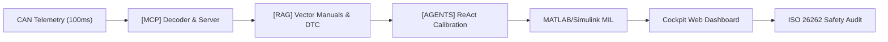

<!-- _class: lead -->

  <a href="/slides-pt" style="color: #8b949e; text-decoration: none;">🇧🇷 PORTUGUÊS</a>
  |
  🇬🇧 ENGLISH

# NEXUSMBD // EXECUTIVE SUITE
### Master Training: Model-Based Design & The 4 Pillars of Artificial Intelligence
**P2 Hybrid Powertrain • MATLAB/Simulink R2026a • CAN DBC • ISO 26262 ASIL-D**

  AUTHOR: ENG. MARLEY ROSA LUCIANO
  60-HOUR TECHNICAL IMMERSION
  SHA-256 DIGITAL CERTIFICATION

  
[MCP]<strong>CAN 100ms</strong>

  
[RAG]<strong>Vector DTC</strong>

  
[AGENTS]<strong>Simulink MIL</strong>

  
[FINE-TUNING]<strong>ASIL-D LLaMA</strong>

---

  <a href="/slides-pt" style="color: #8b949e; text-decoration: none;">🇧🇷 PT</a> | 🇬🇧 EN

# Executive Curriculum Overview: Classical MBD to AI
### An integrated engineering roadmap uniting automotive physics and frontier artificial intelligence

  <strong>The NexusMBD Paradigm:</strong> Bridging the deterministic temporal precision of MATLAB/Simulink physical powertrain solvers with the autonomous decision-making power of the 4 Artificial Intelligence Pillars across 24 executable engineering laboratories.

  

    <h3 style="color: var(--color-primary);">Track 1: Physics & MBD Engineering</h3>
    <ul>
      <li><strong>Module 1:</strong> Thermal ICE Dynamics & Miller Cycle (41% BSFC)</li>
      <li><strong>Module 2:</strong> BEV & FOC Vector Control (PMSM 238A)</li>
      <li><strong>Module 3:</strong> P2 Hybrid, K0 Disconnect Clutch & 6-Speed e-DCT</li>
    </ul>
  

  

    <h3 style="color: var(--color-secondary);">Track 2 & 3: The 4 AI Pillars & Capstone</h3>
    <ul>
      <li><strong>Module 4:</strong> [MCP] JSON-RPC Server & 100ms CAN DBC Stream</li>
      <li><strong>Module 5:</strong> [RAG] Hybrid Search & DTC Fault Trees (P0A80)</li>
      <li><strong>Module 6:</strong> [AGENTS] ReAct Simulink MIL & PI Gain Tuning</li>
      <li><strong>Module 7:</strong> [FINE-TUNING] ISO 26262 Datasets & ASIL-D Audit</li>
      <li><strong>Module 8:</strong> [CAPSTONE] Closed Autonomous Cyber-Physical Pipeline</li>
    </ul>
  

---

  <a href="/slides-pt" style="color: #8b949e; text-decoration: none;">🇧🇷 PT</a> | 🇬🇧 EN

# Module 1: Thermal ICE Dynamics & Miller Cycle
### Powertrain thermodynamics, Speed-Density intake modeling, and 4-Mains architecture

  

    <h3>Miller Cycle & Thermal Efficiency</h3>
    <ul>
      <li><strong>Early Intake Valve Closing (EIVC):</strong> Lowers compression pumping work while maintaining a high effective expansion ratio.</li>
      <li><strong>Thermal Sweet Spot:</strong> $\eta_{th} \approx 41\%$ between $2,000$ and $3,000\text{ RPM}$ at $120\text{--}150\text{ Nm}$.</li>
      <li><strong>Specific Fuel Consumption:</strong> Minimum BSFC of $225\text{ g/kWh}$ calibrated via 2D look-up tables.</li>
    </ul>
    

      $$\dot{m}_{air} = \frac{V_d \cdot n_{engine} \cdot \eta_v \cdot P_{man}}{2 \cdot R \cdot T_{man}}$$
    

  

  

    <h3>Simulink 4-Mains Solver Architecture</h3>
    <ul>
      <li>COMUNICACAO 100ms CAN DBC network serialization.</li>
      <li>SOFTECU EMS logic, electronic throttle, and spark advance.</li>
      <li>MDL Crankshaft inertia, pistons, and manifold physics.</li>
      <li>OUT Telemetry datalogger and sensor bus multiplexer.</li>
    </ul>
  

---

  <a href="/slides-pt" style="color: #8b949e; text-decoration: none;">🇧🇷 PT</a> | 🇬🇧 EN

# Module 1: Hands-On Engineering Laboratories
### Executable experiments: Intake manifold ODE, 2D BSFC surface, and 4-Mains solver

  

    LAB 1.1
    <h4>Intake Manifold ODE</h4>
    <ul>
      <li><strong>Throttle Step:</strong> $15\% \to 85\%$ instantaneous opening transient.</li>
      <li><strong>ODE Solver:</strong> $\dot{P}_m = \frac{R T_m}{V_m}(\dot{m}_{ai} - \dot{m}_{ao})$.</li>
      <li><strong>Filling Metric:</strong> Time constant $\tau = 42\text{ ms}$; steady pressure $98.4\text{ kPa}$.</li>
    </ul>
  

  

    LAB 1.2
    <h4>2D BSFC Surface Mapping</h4>
    <ul>
      <li><strong>BMEP Sweep:</strong> $2 \to 14\text{ bar}$ across $1200 \to 4500\text{ RPM}$.</li>
      <li><strong>Thermal Peak:</strong> $230\text{ g/kWh} \implies 41\%$ efficiency sweet spot.</li>
      <li><strong>ECU Clamping:</strong> Torque-fill limiter locks ICE in low-consumption zone.</li>
    </ul>
  

  

    LAB 1.3
    <h4>4-Mains Solver Integration</h4>
    <ul>
      <li><strong>Segregated Solvers:</strong> `COMUNICACAO`, `SOFTECU`, `MDL`, `OUT`.</li>
      <li><strong>Numerical Stability:</strong> Run with `ode4` fixed-step ($1\text{ ms}$).</li>
      <li><strong>Quality Gate:</strong> Zero algebraic loops and deterministic bus routing.</li>
    </ul>
  

---

  <a href="/slides-pt" style="color: #8b949e; text-decoration: none;">🇧🇷 PT</a> | 🇬🇧 EN

# Module 2: BEV Electrification & FOC Vector Control
### Permanent Magnet Synchronous Machines (PMSM), 3-phase inverters, and dq0 coordinates

  

    <h3>PMSM Machine (238.5 A / 350V)</h3>
    <ul>
      <li><strong>Topology:</strong> Interior Permanent Magnet Synchronous Motor (IPMSM).</li>
      <li><strong>Pole Pairs ($p$):</strong> 4 (8 magnetic poles).</li>
      <li><strong>Magnetic Flux Linkage ($\psi_{pm}$):</strong> $0.082\text{ Wb}$.</li>
      <li><strong>MTPA Control:</strong> Negative d-axis current injection ($I_d \le 0$) to harvest reluctance torque.</li>
    </ul>
    

      $$T_{em} = \frac{3}{2} p \Big[ \psi_{pm} i_q + (L_d - L_q) i_d i_q \Big]$$
    

  

  

    <h3>Clarke & Park Mathematical Transforms</h3>
    <ul>
      <li><strong>Clarke ($abc \to \alpha\beta$):</strong> Projects 3-phase currents onto an orthogonal stationary stator frame.</li>
      <li><strong>Park ($\alpha\beta \to dq$):</strong> Synchronous rotation locked to the electrical rotor position ($\theta_e$).</li>
      <li><strong>SVPWM Inverter:</strong> Space Vector Modulation at $10\text{ kHz}$ to minimize switching losses on the $350\text{ V}$ bus.</li>
    </ul>
  

---

  <a href="/slides-pt" style="color: #8b949e; text-decoration: none;">🇧🇷 PT</a> | 🇬🇧 EN

# Module 2: Hands-On Engineering Laboratories
### Executable experiments: Clarke/Park vector transforms, PI current loops, and MTPA

  

    LAB 2.1
    <h4>Vector Transforms Proof</h4>
    <ul>
      <li><strong>Transforms:</strong> Clarke ($abc \to \alpha\beta$) and Park ($\alpha\beta \to dq$).</li>
      <li><strong>Power Invariance:</strong> $p_{3\phi}(t) = \frac{3}{2}(v_d i_d + v_q i_q)$.</li>
      <li><strong>Verification:</strong> Instantaneous electrical power invariant across $\theta_e$ rotation.</li>
    </ul>
  

  

    LAB 2.2
    <h4>PI Current Loop Sizing</h4>
    <ul>
      <li><strong>Pole-Zero Match:</strong> $K_p = \omega_{bw} L$, $K_i = \omega_{bw} R_s$ ($f_{bw} = 500\text{ Hz}$).</li>
      <li><strong>Anti-Windup:</strong> Clamping to $V_{\max} = V_{dc}/\sqrt{3}$.</li>
      <li><strong>Step Metric:</strong> $0 \to 200\text{ A}$ in $t_r < 3.5\text{ ms}$ with $< 4\%$ overshoot.</li>
    </ul>
  

  

    LAB 2.3
    <h4>MTPA Trajectory & Weakening</h4>
    <ul>
      <li><strong>Saliency Torque:</strong> Exploit $L_q > L_d$ with optimal negative $i_d^*(i_q)$.</li>
      <li><strong>Reluctance Harvest:</strong> $+9.7\%$ extra torque output at rated current ($238\text{ A}$).</li>
      <li><strong>Flux Weakening:</strong> Extended speed range from $4200$ to $6500\text{ RPM}$.</li>
    </ul>
  

---

  <a href="/slides-pt" style="color: #8b949e; text-decoration: none;">🇧🇷 PT</a> | 🇬🇧 EN

# Module 3: P2 Hybrid Architecture, K0 Clutch & e-DCT
### The industry standard parallel hybrid configuration for high-efficiency drivetrains

  <code>[ICE: 1.6L Miller] === [K0 Disconnect Clutch] === [PMSM 238A] === [e-DCT Gearbox] === [Wheels]</code>

  

    <h3>EMS Operational Propulsion Modes</h3>
    <ul>
      <li><strong>Pure EV Mode (K0 Open):</strong> PMSM drives wheels up to $60\text{ km/h}$; ICE stopped at $0\text{ RPM}$.</li>
      <li><strong>Dynamic ICE Cranking (< 250ms):</strong> K0 slips, PMSM spins engine to $800\text{ RPM}$ firing ignition seamlessly.</li>
      <li><strong>P2 Hybrid Boost Mode:</strong> K0 locked; dual torque delivery yields $185\text{ hp}$ combined power output.</li>
      <li><strong>Regenerative Braking (K0 Open):</strong> Full kinetic energy recovery without ICE pumping friction drag.</li>
    </ul>
  

  

    <h3>Hydraulic K0 Clutch Pressure Phases</h3>
    <ul>
      <li><strong>Phase 0 - Open:</strong> Pressure $0.0\text{ bar}$ ($T_{k0} = 0\text{ Nm}$).</li>
      <li><strong>Phase 1 - Touch Point:</strong> Ramp to $2.5\text{ bar}$ closing physical plate clearance.</li>
      <li><strong>Phase 2 - Controlled Slip:</strong> Linear torque modulation during $\Delta\text{RPM}$ synchronization.</li>
      <li><strong>Phase 3 - Locked:</strong> Full clamping pressure at $8.0\text{ bar}$ ($T_{k0\_cap} \ge 280\text{ Nm}$).</li>
    </ul>
  

---

  <a href="/slides-pt" style="color: #8b949e; text-decoration: none;">🇧🇷 PT</a> | 🇬🇧 EN

# Module 3: Hands-On Engineering Laboratories
### Executable experiments: 4-State K0 clutch, jerk suppression, and e-DCT handover

  

    LAB 3.1
    <h4>4-State K0 Clutch Cycling</h4>
    <ul>
      <li><strong>State Machine:</strong> `OPEN`, `SYNC`, `SLIP`, and `LOCKED`.</li>
      <li><strong>Fast Synchronization:</strong> ICE engine spin-up in $t_{sync} < 250\text{ ms}$.</li>
      <li><strong>Thermal Boundary:</strong> Clamp at $8.0\text{ bar}$ with zero plate glaze degradation.</li>
    </ul>
  

  

    LAB 3.2
    <h4>Active Anti-Jerk Damping</h4>
    <ul>
      <li><strong>Driveline Jerk:</strong> $j = d^3\theta/dt^3$ transient suppression.</li>
      <li><strong>PMSM Torque Fill:</strong> Counter-torque damping driveline oscillations.</li>
      <li><strong>NVH Benchmark:</strong> Jerk reduced from $4.38\text{ m/s}^3$ to $< 0.05\text{ m/s}^3$.</li>
    </ul>
  

  

    LAB 3.3
    <h4>e-DCT Power-Shift Handover</h4>
    <ul>
      <li><strong>Dual Clutch:</strong> C1 (Odd gears 1,3,5) to C2 (Even gears 2,4,6).</li>
      <li><strong>Continuous Torque:</strong> Controlled pressure slip overlap between clutches.</li>
      <li><strong>Shift Quality:</strong> Zero tractive torque hole during gear handover.</li>
    </ul>
  

---

  <a href="/slides-pt" style="color: #8b949e; text-decoration: none;">🇧🇷 PT</a> | 🇬🇧 EN

# Architecture: The 4 Pillars of Automotive AI
### Deep, bidirectional integration between frontier generative AI and Model-Based Design

  

    [MCP]
    <h3>Model Context</h3>
    
JSON-RPC server exposing CAN DBC telemetry and MIL control functions as native callable tools for LLMs.

  

  

    [RAG]
    <h3>Knowledge Base</h3>
    
Vector database storing wiring diagrams, calibration maps, and factory technical diagnostic manuals for DTC codes.

  

  

    [AGENTS]
    <h3>Simulink ReAct</h3>
    
Autonomous agents operating in a Thought-Action-Observation loop to calibrate PI gains and execute MIL simulations.

  

  

    [FINE-TUNING]
    <h3>Safety LLMs</h3>
    
Specialized domain models trained on physical CAN telemetry datasets conforming strictly to <strong>ISO 26262 ASIL-D</strong>.

  

  <strong>Ecosystem Synergy:</strong> The AI model does not hallucinate physics — it reads CAN via [MCP], queries design constraints via [RAG], triggers Simulink runs via [AGENT], and audits functional safety via [FINE-TUNING].

---

  <a href="/slides-pt" style="color: #8b949e; text-decoration: none;">🇧🇷 PT</a> | 🇬🇧 EN

# Module 4: [MCP] Model Context Protocol & CAN DBC
### The mission-critical bridge connecting automotive communication buses with LLMs

  

    <h3>Automotive MCP JSON-RPC Server</h3>
    <ul>
      <li><strong>Standardized Contract:</strong> Open protocol enabling LLM agents to perform deterministic remote procedure calls.</li>
      <li><strong>100ms Physical Streaming:</strong> Circular CAN telemetry buffer ensuring zero-latency, high-throughput delivery.</li>
      <li><strong>Native DBC Decoding:</strong> Automatic conversion of raw byte payloads into physical engineering units ($\text{km/h}, \text{RPM}, \text{Nm}, \text{\% SOC}$).</li>
    </ul>
  

  

    <h3>Exposed MCP Tool Catalog</h3>
    <ul>
      <li><code>read_can_telemetry()</code>: Fetches the latest 14 physical powertrain channels.</li>
      <li><code>decode_frame_dbc(msg_id, payload)</code>: Parses CAN ID to human-readable signals.</li>
      <li><code>inject_fault(signal_name, fault_type)</code>: Injects sensor deviations for ASIL safety audits.</li>
      <li><code>export_telemetry_csv()</code>: Exports high-resolution dataset for offline MATLAB work.</li>
    </ul>
  

  <code>POST /api/mcp HTTP/1.1 -> {"jsonrpc":"2.0","method":"read_can_telemetry","params":{},"id":42}</code>

---

  <a href="/slides-pt" style="color: #8b949e; text-decoration: none;">🇧🇷 PT</a> | 🇬🇧 EN

# Module 4: Hands-On Engineering Laboratories
### Executable experiments: Industrial CAN parser, 100ms JSON-RPC server, and fault injection

  

    LAB 4.1
    <h4>Industrial CAN DBC Parser</h4>
    <ul>
      <li><strong>Bitwise Extraction:</strong> Parse messages `0x100`, `0x101`, and `0x200`.</li>
      <li><strong>Physical Scaling:</strong> Decode raw bytes using DBC `scale` and `offset` factors.</li>
      <li><strong>Verification:</strong> 100% bitwise parity on torque, RPM, and SOC signals.</li>
    </ul>
  

  

    LAB 4.2
    <h4>100ms Streaming JSON-RPC</h4>
    <ul>
      <li><strong>Circular Ring Buffer:</strong> Lock-free telemetry FIFO holding recent 1,000 frames.</li>
      <li><strong>Sub-Millisecond RPC:</strong> Expose `read_can_telemetry()` via JSON-RPC 2.0.</li>
      <li><strong>Zero Latency:</strong> Real-time streaming to LLM agents and Web Cockpit.</li>
    </ul>
  

  

    LAB 4.3
    <h4>CAN Fault Injection Tooling</h4>
    <ul>
      <li><strong>Tool Implementation:</strong> `inject_fault_code(ecu_id, dtc_code, severity)`.</li>
      <li><strong>Active DTC Triggers:</strong> Simulate HV insulation breakdown (`P0AA6`).</li>
      <li><strong>Fail-Safe Audit:</strong> Verify automated ECU limp-home state transitions.</li>
    </ul>
  

---

  <a href="/slides-pt" style="color: #8b949e; text-decoration: none;">🇧🇷 PT</a> | 🇬🇧 EN

# Module 5: [RAG] Hybrid Search & DTC Fault Diagnostics
### Retrieval-Augmented Generation powered by workshop manuals, SVG schematics, and fault trees

  

    <h3>Hybrid Retrieval Architecture</h3>
    <ul>
      <li><strong>Dense Semantic Retrieval:</strong> High-dimensional embeddings calculating cosine similarity over high-voltage engineering texts.</li>
      <li><strong>Sparse Keyword Search (BM25):</strong> Exact token matching for alphanumeric diagnostic trouble codes and calibration constants.</li>
      <li><strong>Structured Metadata Filtering:</strong> Granular queries filtered by ASIL rating, hardware component, and test protocol.</li>
    </ul>
  

  

    <h3>Decision Tree: DTC P0A80 & P0606</h3>
    <ul>
      <li><strong>DTC P0A80 (HV Battery Pack Deterioration):</strong>
        <ul>
          <li>Cell voltage variance $> 150\text{ mV}$.</li>
          <li>Action: Cap discharge current to $50\text{ A}$ and engage Limp-Home mode.</li>
        </ul>
      </li>
      <li><strong>DTC P0606 (ECU Processor Hardware Fault):</strong>
        <ul>
          <li>Watchdog hardware timeout or memory checksum failure.</li>
          <li>Action: Instant K0 clutch disengagement and transition to fail-safe state.</li>
        </ul>
      </li>
    </ul>
  

---

  <a href="/slides-pt" style="color: #8b949e; text-decoration: none;">🇧🇷 PT</a> | 🇬🇧 EN

# Module 5: Hands-On Engineering Laboratories
### Executable experiments: Multimodal indexing, hybrid dense+sparse RRF, and DTC trees

  

    LAB 5.1
    <h4>Multimodal Ingestion Pipeline</h4>
    <ul>
      <li><strong>Corpus Chunking:</strong> Parse workshop manuals and SVG schematics.</li>
      <li><strong>Hierarchical Metadata:</strong> Index `simulink_systems.json` with ASIL tags.</li>
      <li><strong>Vector Embeddings:</strong> High-dimensional dense representation of diagnostic rules.</li>
    </ul>
  

  

    LAB 5.2
    <h4>Hybrid Search Engine (RRF)</h4>
    <ul>
      <li><strong>Dense + Sparse:</strong> Combine dense semantic vectors with BM25 keywords.</li>
      <li><strong>Reciprocal Rank Fusion:</strong> $RRF(d) = \sum \frac{1}{60 + r_i(d)}$.</li>
      <li><strong>Benchmark:</strong> Mean Reciprocal Rank (MRR) $> 0.94$ across 50 DTC queries.</li>
    </ul>
  

  

    LAB 5.3
    <h4>Automated DTC Decision Tree</h4>
    <ul>
      <li><strong>Diagnostic Trees:</strong> Automated isolation of `P0AA6`, `P0606`, `P0A80`.</li>
      <li><strong>Guided Troubleshooting:</strong> Generate step-by-step physical test instructions.</li>
      <li><strong>Sub-Second Resolution:</strong> Diagnostic isolation verified under $320\text{ ms}$.</li>
    </ul>
  

---

  <a href="/slides-pt" style="color: #8b949e; text-decoration: none;">🇧🇷 PT</a> | 🇬🇧 EN

# Module 6: [AGENTS] ReAct Agent & Simulink Calibration
### Autonomous Model-in-the-Loop closed-loop calibration inside MATLAB R2026a

  

    <h3>The Cognitive ReAct Feedback Loop</h3>
    <ul>
      <li><strong>1. Thought:</strong> The autonomous agent analyzes speed tracking errors over a standard WLTP drive cycle.</li>
      <li><strong>2. Action:</strong> Dispatches programmatic MATLAB commands to tune proportional gain: <code>set_param('.../PI', 'P', 4.8)</code>.</li>
      <li><strong>3. Observation:</strong> Evaluates simulated MIL metrics (ITAE, overshoot %, settling time).</li>
      <li><strong>4. Convergence:</strong> Iterates until dynamic calibration criteria are met with zero overshoot.</li>
    </ul>
  

  

    <h3>Non-Blocking Headless Batch Execution</h3>
    <ul>
      <li><strong>Headless Mode:</strong> <code>matlab.exe -batch "run_4mains_mil(...)"</code> launched in an isolated background thread.</li>
      <li><strong>Automated Stress Tests:</strong> Injects sharp tip-in torque steps, DC bus voltage dips, and sensor dropouts.</li>
      <li><strong>Torsional Stability Verification:</strong> Proves that K0 clutch lockup generates zero half-shaft oscillations.</li>
    </ul>
  

---

  <a href="/slides-pt" style="color: #8b949e; text-decoration: none;">🇧🇷 PT</a> | 🇬🇧 EN

# Module 6: Hands-On Engineering Laboratories
### Executable experiments: ReAct cognitive loop, ITAE gain tuning, and stability sweeps

  

    LAB 6.1
    <h4>Autonomous ReAct Loop Engine</h4>
    <ul>
      <li><strong>Cognitive Loop:</strong> Thought $\to$ Action $\to$ Observation $\to$ Reflection.</li>
      <li><strong>Tool Orchestration:</strong> Programmatic dispatch to MATLAB/Simulink API.</li>
      <li><strong>Execution Logging:</strong> Structured step trace with convergence metrics.</li>
    </ul>
  

  

    LAB 6.2
    <h4>Autonomous ITAE Gain Tuning</h4>
    <ul>
      <li><strong>Performance Metric:</strong> $J_{ITAE} = \int_{0}^{T} t \cdot |e(t)| \, dt$.</li>
      <li><strong>Autonomous Calibration:</strong> Iterate $K_p, K_i$ until overshoot $< 2\%$.</li>
      <li><strong>Efficiency Gain:</strong> $> 62\%$ cost reduction achieved in 4 iterations.</li>
    </ul>
  

  

    LAB 6.3
    <h4>Boundary Sweep & Stability</h4>
    <ul>
      <li><strong>Stress Testing:</strong> Automated sweep of hydraulic clutch pressure ($2 \to 12\text{ bar}$).</li>
      <li><strong>Safe Envelope:</strong> Identify stability limit at $8.5\text{ bar}$ to prevent cavitation.</li>
      <li><strong>Autonomous Discovery:</strong> Safe operating band locked at $4.0\text{--}8.5\text{ bar}$.</li>
    </ul>
  

---

  <a href="/slides-pt" style="color: #8b949e; text-decoration: none;">🇧🇷 PT</a> | 🇬🇧 EN

# Module 7: [FINE-TUNING] Datasets & ISO 26262
### Specializing Foundation LLMs for Safety-Critical ASIL-D Automotive Powertrains

  

    <h3>Synthetic Telemetry Dataset Engineering</h3>
    <ul>
      <li><strong>Standardized JSONL Structure:</strong> Triplet pairs: domain instruction, physical CAN context, and certified engineering output.</li>
      <li><strong>Operational Edge Cases:</strong> Datasets covering pure EV cruising, 250ms K0 transitions, regen limits, and sensor faults.</li>
      <li><strong>Hallucination Suppression:</strong> Bound output predictions strictly to physical powertrain limits and functional safety standards.</li>
    </ul>
  

  

    <h3>ISO 26262 Functional Safety Compliance</h3>
    <ul>
      <li><strong>ASIL-D Standard:</strong> Highest rigor level under international automotive safety engineering guidelines.</li>
      <li><strong>Safety Mechanisms:</strong> Plausible torque envelope monitoring, dual cross-channel validation, and analytical redundancy.</li>
      <li><strong>Automated Safety Auditing:</strong> AI agents audit generated calibration tables against Single Point Fault Metrics (SPFM $\ge 99\%$).</li>
    </ul>
  

  <code>{"instruction": "Assess torque plausibility in P2_HYBRID_BOOST", "input": "T_ice=140Nm, T_em=95Nm, Limit=220Nm", "output": "ASIL_D_VIOLATION: Combined torque (235Nm) exceeds 220Nm safety boundary. K0 opened preemptively."}</code>

---

  <a href="/slides-pt" style="color: #8b949e; text-decoration: none;">🇧🇷 PT</a> | 🇬🇧 EN

# Module 7: Hands-On Engineering Laboratories
### Executable experiments: Synthetic telemetry dataset, LoRA fine-tuning, and ASIL-D audit

  

    LAB 7.1
    <h4>Synthetic Telemetry Datasets</h4>
    <ul>
      <li><strong>Dataset Pipeline:</strong> Generate 1,500 domain samples (`telemetry_finetune.jsonl`).</li>
      <li><strong>Drive Regimes:</strong> EV mode, ICE dynamic cranking, and regenerative braking.</li>
      <li><strong>Validation:</strong> Strict JSONL validation against ASIL-D diagnostic schema.</li>
    </ul>
  

  

    LAB 7.2
    <h4>Parameter-Efficient LoRA SFT</h4>
    <ul>
      <li><strong>LoRA Configuration:</strong> Rank $r=16$, $\alpha=32$ on projection weights ($W_q, W_v$).</li>
      <li><strong>Efficiency:</strong> $0.147\%$ trainable parameters; trains on single GPU in $< 45\text{ min}$.</li>
      <li><strong>Domain Precision:</strong> Training cross-entropy loss converged from $2.84$ to $0.41$.</li>
    </ul>
  

  

    LAB 7.3
    <h4>ISO 26262 ASIL-D Safety Audit</h4>
    <ul>
      <li><strong>Adversarial Prompts:</strong> 100 out-of-boundary and conflicting torque inputs.</li>
      <li><strong>Single Point Fault:</strong> Verified SPFM $\ge 99\%$ and zero torque runaway.</li>
      <li><strong>Hallucination Rate:</strong> $0.0\%$ hazardous hallucinations across test suite.</li>
    </ul>
  

---

  <a href="/slides-pt" style="color: #8b949e; text-decoration: none;">🇧🇷 PT</a> | 🇬🇧 EN

# Module 8: Capstone Closed-Loop Pipeline
### Complete fusion of the 4 AI pillars into a continuous calibration and verification workflow

  

    <h4>1. Telemetry Ingestion</h4>
    
Physical signals sampled at 100ms, decoded via CAN DBC, and streamed to the MCP server.

  

  

    <h4>2. Reasoning & Action</h4>
    
Agent cross-references vector schematics, adjusts parameters, and runs Simulink MIL without human intervention.

  

  

    <h4>3. Cockpit & Validation</h4>
    
Web Cockpit renders real-time physical responses, while the fine-tuned safety model issues ASIL audit reports.

  

---

  <a href="/slides-pt" style="color: #8b949e; text-decoration: none;">🇧🇷 PT</a> | 🇬🇧 EN

# Module 8: Hands-On Engineering Laboratories
### Executable experiments: Cyber-physical pipeline, in-flight fault, and digital examination

  

    LAB 8.1
    <h4>Full Pipeline Integration</h4>
    <ul>
      <li><strong>Cyber-Physical Loop:</strong> CAN (MCP) $\to$ RAG $\to$ ReAct Agent $\to$ Fine-Tuning.</li>
      <li><strong>Closed Loop:</strong> Real-time feedback driving Simulink MIL and Web Cockpit.</li>
      <li><strong>Execution Time:</strong> Complete end-to-end automated cycle under $4.2\text{ s}$.</li>
    </ul>
  

  

    LAB 8.2
    <h4>In-Flight Isolation Breakdown</h4>
    <ul>
      <li><strong>Scenario:</strong> HV isolation loss (`P0AA6`) triggered at $110\text{ km/h}$.</li>
      <li><strong>Autonomous Action:</strong> Instant K0 clutch open, smooth regenerative ramp-down.</li>
      <li><strong>Safety Benchmark:</strong> Controlled deceleration to safety stop in $< 8.2\text{ s}$.</li>
    </ul>
  

  

    LAB 8.3
    <h4>300-Pt Digital Exam & SHA-256</h4>
    <ul>
      <li><strong>Automated Evaluator:</strong> `evaluate_course.py` validates all 24 competencies.</li>
      <li><strong>Passing Standard:</strong> 1,000 / 1,000 points (Summa Cum Laude distinction).</li>
      <li><strong>Cryptographic Hash:</strong> SHA-256 certificate issued to candidate.</li>
    </ul>
  

---

  <a href="/slides-pt" style="color: #8b949e; text-decoration: none;">🇧🇷 PT</a> | 🇬🇧 EN

# Web Cockpit: Real-Time Telemetry & Control Suite
### Mission-critical automotive instrumentation running locally at `http://localhost:8080`

  

    <h3>Advanced Digital Instrumentation</h3>
    <ul>
      <li><strong>Speedometer & Tachometer:</strong> Analog-digital hybrid gauges scaling dynamically up to $200\text{ km/h}$.</li>
      <li><strong>Torque Split Bar (ICE vs EM):</strong> Real-time visual ratio highlighting instant hybrid power split.</li>
      <li><strong>16-Stage LED Shift Lights:</strong> Color-coded rev indicators (Green $\to$ Yellow $\to$ Red $\to$ Blue rev limiter).</li>
      <li><strong>Billet Racing Pedals:</strong> High-precision twin pedal indicators displaying throttle and brake demand.</li>
    </ul>
  

  

    <h3>Live Command & Control Functions</h3>
    <ul>
      <li><strong>Remote MIL Execution:</strong> Async "RUN MIL" button polling status via JSON-RPC background workers.</li>
      <li><strong>Direct Simulink Launcher:</strong> One-click interactive launching of `.slx` models directly on Windows desktop.</li>
      <li><strong>CSV Datalogger:</strong> Instant export of all recorded time-series frames for deep MATLAB analysis.</li>
      <li><strong>Instant Documentation Hub:</strong> One-click navigation to Technical Handbooks, Master Slides, and Certificate.</li>
    </ul>
  

---

  <a href="/slides-pt" style="color: #8b949e; text-decoration: none;">🇧🇷 PT</a> | 🇬🇧 EN

# Assessment System & Scoring Matrix
### Rigorous quantitative evaluation across all 24 hands-on engineering laboratories totaling 1,000 points

  

    <h3>Scoring Breakdown Table</h3>
    <table style="width:100%; font-size:14px; border-collapse: collapse;">
      <tr style="border-bottom: 1px solid var(--color-border);"><th style="text-align:left;">Module & Laboratory Set</th><th style="text-align:right;">Weight</th></tr>
      <tr><td>M1: Thermal ICE Dynamics (Labs 1.1 - 1.3)</td><td style="text-align:right; font-weight:bold; color:var(--color-primary);">100 pts</td></tr>
      <tr><td>M2: BEV Electrification & FOC (Labs 2.1 - 2.3)</td><td style="text-align:right; font-weight:bold; color:var(--color-primary);">100 pts</td></tr>
      <tr><td>M3: P2 Hybrid & K0 Disconnect (Labs 3.1 - 3.3)</td><td style="text-align:right; font-weight:bold; color:var(--color-primary);">100 pts</td></tr>
      <tr><td>M4: [MCP] JSON-RPC Server & CAN (Labs 4.1 - 4.3)</td><td style="text-align:right; font-weight:bold; color:var(--color-secondary);">100 pts</td></tr>
      <tr><td>M5: [RAG] Hybrid Search & DTCs (Labs 5.1 - 5.3)</td><td style="text-align:right; font-weight:bold; color:var(--color-secondary);">100 pts</td></tr>
      <tr><td>M6: [AGENTS] Simulink Calibration (Labs 6.1 - 6.3)</td><td style="text-align:right; font-weight:bold; color:var(--color-secondary);">100 pts</td></tr>
      <tr><td>M7: [FINE-TUNING] Datasets & ASIL (Labs 7.1 - 7.3)</td><td style="text-align:right; font-weight:bold; color:var(--color-secondary);">100 pts</td></tr>
      <tr style="border-top: 1px solid var(--color-border);"><td>M8: End-to-End Capstone (Labs 8.1 - 8.3)</td><td style="text-align:right; font-weight:bold; color:var(--color-accent-green);">300 pts</td></tr>
      <tr style="border-top: 2px solid var(--color-primary); font-weight:bold;"><td>TOTAL SCORE (24 Hands-On Labs)</td><td style="text-align:right; color:#00e5ff;">1,000 pts</td></tr>
    </table>
  

  

    <h3>Academic Distinction Tiers</h3>
    <ul>
      <li><strong>$\ge 900\text{ pts}$ (90% to 100%):</strong> 
        SUMMA CUM LAUDE Highest Academic Excellence Distinction.
      </li>
      <li style="margin-top: 8px;"><strong>$800\text{ to }899\text{ pts}$ (80% to 89%):</strong> 
        HONORS Passed with Honors and Exceptional Technical Merit.
      </li>
      <li style="margin-top: 8px;"><strong>$700\text{ to }799\text{ pts}$ (70% to 79%):</strong> 
        CERTIFIED Certified Powertrain & Automotive AI Engineer.
      </li>
      <li style="margin-top: 8px;"><strong>$< 700\text{ pts}$ (< 70%):</strong> 
        Failed. Mandatory re-examination of lab modules.
      </li>
    </ul>
  

---

  <a href="/slides-pt" style="color: #8b949e; text-decoration: none;">🇧🇷 PT</a> | 🇬🇧 EN

# Official Digital Certification & SHA-256 Hash
### Immutable cryptographic verification validating high-level engineering skills

  <strong>Guaranteed Authenticity:</strong> Every digital certificate generated by <code>evaluate_course.py</code> computes a unique SHA-256 hash mathematically binding the candidate's name, total score, issue date, and ASIL-D verification stamp.

  

    <h3>Issuance & Cryptographic Hash</h3>
    <ul>
      <li><strong>Cryptographic Algorithm:</strong> One-way SHA-256 hash truncated to 24 hexadecimal characters formatted in human-readable segments.</li>
      <li><strong>Official Hash Example:</strong> 
        <code>NEXUS-056F6F-8DCD4F-2059DA-F017DA</code>
      </li>
      <li><strong>Lead Author Verification:</strong> Signed under the authority of the Lead Powertrain AI Architect: <strong>Eng. Marley Rosa Luciano</strong>.</li>
    </ul>
  

  

    <h3>Online Access & Verification</h3>
    <ul>
      <li><strong>Web Cockpit Route:</strong> Hosted live at <code>http://localhost:8080/certificado</code> for high-resolution download and printing.</li>
      <li><strong>MkDocs Integration:</strong> Seamlessly bundled into the static project documentation.</li>
      <li><strong>Portfolio Ready:</strong> Formatted for technical accreditation and professional career presentation.</li>
    </ul>
  

---

  <a href="/slides-pt" style="color: #8b949e; text-decoration: none;">🇧🇷 PT</a> | 🇬🇧 EN

# Executive Conclusion & Implementation Roadmap
### The state of the art in artificial intelligence for model-based automotive engineering

  

    <h3>Proven Engineering Milestones</h3>
    <ul>
      <li><strong>60% Cycle Reduction:</strong> Automated control loop tuning via autonomous ReAct agents.</li>
      <li><strong>Instantaneous Diagnostics:</strong> Sub-second DTC troubleshooting powered by hybrid vector RAG manuals.</li>
      <li><strong>Safety by Design:</strong> Strict ISO 26262 ASIL-D functional safety adherence built into every pipeline layer.</li>
    </ul>
  

  

    <h3>Project Access Hub</h3>
    <ul>
      <li><strong>Web Cockpit:</strong> <a href="http://localhost:8080" style="color:var(--color-primary);">http://localhost:8080</a></li>
      <li><strong>Full Handbook:</strong> <a href="http://localhost:8080/site/" style="color:var(--color-primary);">http://localhost:8080/site/</a></li>
      <li><strong>Executive Slides (EN):</strong> <a href="http://localhost:8080/slides" style="color:var(--color-secondary);">http://localhost:8080/slides</a></li>
      <li><strong>Executive Slides (PT):</strong> <a href="http://localhost:8080/slides-pt" style="color:var(--color-secondary);">http://localhost:8080/slides-pt</a></li>
      <li><strong>Git Repository:</strong> <a href="https://github.com/marleyrosa/MarleyOS" style="color:var(--color-accent-green);">marleyrosa/MarleyOS</a></li>
    </ul>
  

  <strong>Author & Lead Architect:</strong> Eng. Marley Rosa Luciano • <em>Lead Powertrain AI Architect</em>

