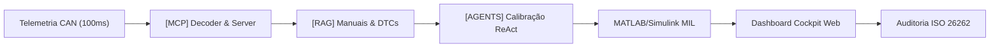

<!-- _class: lead -->

  🇧🇷 PORTUGUÊS
  |
  <a href="/slides" style="color: #8b949e; text-decoration: none;">🇬🇧 ENGLISH</a>

# NEXUSMBD // SUITE EXECUTIVA
### Formação Master: Model-Based Design & Os 4 Pilares de Inteligência Artificial
**Powertrain Híbrido P2 • MATLAB/Simulink R2026a • CAN DBC • ISO 26262 ASIL-D**

  AUTOR: ENG. MARLEY ROSA LUCIANO
  60 HORAS DE IMERSÃO TÉCNICA
  CERTIFICAÇÃO DIGITAL SHA-256

  
[MCP]<strong>CAN 100ms</strong>

  
[RAG]<strong>Vetorial DTC</strong>

  
[AGENTS]<strong>Simulink MIL</strong>

  
[FINE-TUNING]<strong>ASIL-D LLaMA</strong>

---

  🇧🇷 PT | <a href="/slides" style="color: #8b949e; text-decoration: none;">🇬🇧 EN</a>

# Visão Geral da Formação: Do MBD Clássico à IA
### Uma jornada integrada de engenharia automotiva e inteligência artificial

  <strong>O Paradigma NexusMBD:</strong> Unir a precisão temporal determinística dos modelos físicos no MATLAB/Simulink com a autonomia decisória dos 4 Pilares de Inteligência Artificial através de 24 práticas laboratoriais de engenharia executáveis.

  

    <h3 style="color: var(--color-primary);">Trilha 1: Física & Engenharia MBD</h3>
    <ul>
      <li><strong>Módulo 1:</strong> Dinâmica Térmica ICE & Ciclo Miller (BSFC 41%)</li>
      <li><strong>Módulo 2:</strong> BEV & Controle Vetorial FOC (PMSM 238A)</li>
      <li><strong>Módulo 3:</strong> Híbrido P2, Embreagem K0 & e-DCT 6-Speed</li>
    </ul>
  

  

    <h3 style="color: var(--color-secondary);">Trilha 2 & 3: Os 4 Pilares de IA & Capstone</h3>
    <ul>
      <li><strong>Módulo 4:</strong> [MCP] Servidor JSON-RPC & CAN DBC 100ms</li>
      <li><strong>Módulo 5:</strong> [RAG] Busca Híbrida & Árvores DTC (P0A80)</li>
      <li><strong>Módulo 6:</strong> [AGENTS] ReAct Simulink MIL & Calibração PI</li>
      <li><strong>Módulo 7:</strong> [FINE-TUNING] Datasets ISO 26262 & ASIL-D Audit</li>
      <li><strong>Módulo 8:</strong> [CAPSTONE] Pipeline Cibernético-Físico Fechado</li>
    </ul>
  

---

  🇧🇷 PT | <a href="/slides" style="color: #8b949e; text-decoration: none;">🇬🇧 EN</a>

# Módulo 1: Dinâmica Térmica ICE & Ciclo Miller
### Termodinâmica veicular, admissão Speed-Density e arquitetura 4 Mains

  

    <h3>Ciclo Miller & Eficiência Térmica</h3>
    <ul>
      <li><strong>Fechamento Antecipado (EIVC):</strong> Reduz trabalho de compressão e eleva taxa de expansão efetiva.</li>
      <li><strong>Sweet Spot Térmico:</strong> $\eta_{th} \approx 41\%$ na faixa de $2.000$ a $3.000\text{ RPM}$ com $120\text{--}150\text{ Nm}$.</li>
      <li><strong>Consumo Específico:</strong> Mínimo BSFC de $225\text{ g/kWh}$ calibrado via mapas bidimensionais.</li>
    </ul>
    

      $$\dot{m}_{air} = \frac{V_d \cdot n_{engine} \cdot \eta_v \cdot P_{man}}{2 \cdot R \cdot T_{man}}$$
    

  

  

    <h3>Arquitetura 4 Mains no Simulink</h3>
    <ul>
      <li>COMUNICACAO Serialização CAN DBC a 100ms.</li>
      <li>SOFTECU EMS, controle de borboleta e ponto de ignição.</li>
      <li>MDL Dinâmica física de virabrequim, pistões e coletor.</li>
      <li>OUT Datalogger de telemetria e barramento de sensores.</li>
    </ul>
  

---

  🇧🇷 PT | <a href="/slides" style="color: #8b949e; text-decoration: none;">🇬🇧 EN</a>

# Módulo 1: Práticas Laboratoriais de Engenharia
### Experimentos executáveis: ODE do coletor de admissão, mapa 2D BSFC e arquitetura 4 Mains

  

    LAB 1.1
    <h4>Dinâmica do Coletor de Ar</h4>
    <ul>
      <li><strong>Degrau de Borboleta:</strong> Abertura rápida de $15\% \to 85\%$.</li>
      <li><strong>Solução ODE:</strong> $\dot{P}_m = \frac{R T_m}{V_m}(\dot{m}_{ai} - \dot{m}_{ao})$.</li>
      <li><strong>Métrica:</strong> Constante de tempo $\tau = 42\text{ ms}$; regime a $98.4\text{ kPa}$.</li>
    </ul>
  

  

    LAB 1.2
    <h4>Otimização 2D de BSFC</h4>
    <ul>
      <li><strong>Varredura BMEP:</strong> $2 \to 14\text{ bar}$ entre $1200 \to 4500\text{ RPM}$.</li>
      <li><strong>Pico Térmico:</strong> Sweet spot de $230\text{ g/kWh} \implies 41\%$ de eficiência.</li>
      <li><strong>Trava da ECU:</strong> Torque-fill limita operação do ICE no contorno ótimo.</li>
    </ul>
  

  

    LAB 1.3
    <h4>Integração 4-Mains Solver</h4>
    <ul>
      <li><strong>Solvers Segregados:</strong> `COMUNICACAO`, `SOFTECU`, `MDL`, `OUT`.</li>
      <li><strong>Estabilidade Numérica:</strong> Execução sob solver de passo fixo `ode4` ($1\text{ ms}$).</li>
      <li><strong>Critério de Qualidade:</strong> Zero loops algébricos e roteamento estrito.</li>
    </ul>
  

---

  🇧🇷 PT | <a href="/slides" style="color: #8b949e; text-decoration: none;">🇬🇧 EN</a>

# Módulo 2: Eletrificação BEV & Controle Vetorial FOC
### Máquinas Síncronas de Ímã Permanente (PMSM), inversores trifásicos e coordenadas dq0

  

    <h3>Máquina PMSM (238.5 A / 350V)</h3>
    <ul>
      <li><strong>Topologia:</strong> Interior Permanent Magnet Synchronous Motor (IPMSM).</li>
      <li><strong>Pares de Polos ($p$):</strong> 4 (8 polos magnéticos).</li>
      <li><strong>Fluxo de Enlace ($\psi_{pm}$):</strong> $0.082\text{ Wb}$.</li>
      <li><strong>Controle MTPA:</strong> Injeção negativa no eixo d ($I_d \le 0$) para torque de relutância.</li>
    </ul>
    

      $$T_{em} = \frac{3}{2} p \Big[ \psi_{pm} i_q + (L_d - L_q) i_d i_q \Big]$$
    

  

  

    <h3>Transformadas de Clarke & Park</h3>
    <ul>
      <li><strong>Clarke ($abc \to \alpha\beta$):</strong> Projeta correntes trifásicas em referencial estacionário.</li>
      <li><strong>Park ($\alpha\beta \to dq$):</strong> Rotação síncrona travada à posição do rotor elétrico ($\theta_e$).</li>
      <li><strong>Inversor SVPWM:</strong> Modulação por Vetor Espacial a $10\text{ kHz}$ no barramento de $350\text{ V}$.</li>
    </ul>
  

---

  🇧🇷 PT | <a href="/slides" style="color: #8b949e; text-decoration: none;">🇬🇧 EN</a>

# Módulo 2: Práticas Laboratoriais de Engenharia
### Experimentos executáveis: Transformadas Clarke/Park, malhas PI de corrente e MTPA

  

    LAB 2.1
    <h4>Prova de Invariância de Potência</h4>
    <ul>
      <li><strong>Transformadas:</strong> Clarke ($abc \to \alpha\beta$) e Park ($\alpha\beta \to dq$).</li>
      <li><strong>Equação Invariante:</strong> $p_{3\phi}(t) = \frac{3}{2}(v_d i_d + v_q i_q)$.</li>
      <li><strong>Verificação:</strong> Potência elétrica instantânea invariante na rotação $\theta_e$.</li>
    </ul>
  

  

    LAB 2.2
    <h4>Sintonia PI com Anti-Windup</h4>
    <ul>
      <li><strong>Cancelamento Polo-Zero:</strong> $K_p = \omega_{bw} L$, $K_i = \omega_{bw} R_s$ ($500\text{ Hz}$).</li>
      <li><strong>Anti-Windup:</strong> Grampeamento de saturação em $V_{\max} = V_{dc}/\sqrt{3}$.</li>
      <li><strong>Métrica:</strong> Resposta $0 \to 200\text{ A}$ em $t_r < 3.5\text{ ms}$ com sobre-sinal $< 4\%$.</li>
    </ul>
  

  

    LAB 2.3
    <h4>Trajetória MTPA & Enfraquecimento</h4>
    <ul>
      <li><strong>Torque de Saliência:</strong> Explora $L_q > L_d$ com $i_d^*(i_q)$ ótimo negativo.</li>
      <li><strong>Ganho de Relutância:</strong> $+9.7\%$ de torque adicional na corrente nominal ($238\text{ A}$).</li>
      <li><strong>Enfraquecimento de Campo:</strong> Extensão de rotação de $4200$ para $6500\text{ RPM}$.</li>
    </ul>
  

---

  🇧🇷 PT | <a href="/slides" style="color: #8b949e; text-decoration: none;">🇬🇧 EN</a>

# Módulo 3: Híbrido P2, Embreagem K0 & e-DCT
### A arquitetura híbrida paralela de alta eficiência consagrada na indústria

  <code>[ICE: 1.6L Miller] === [Embreagem K0] === [PMSM 238A] === [Câmbio e-DCT] === [Rodas]</code>

  

    <h3>Modos Operacionais da ECU</h3>
    <ul>
      <li><strong>Modo 100% EV (K0 Aberta):</strong> PMSM traciona até $60\text{ km/h}$; ICE desligado a $0\text{ RPM}$.</li>
      <li><strong>Partida Dinâmica ICE (< 250ms):</strong> K0 patina, PMSM gira motor a $800\text{ RPM}$ e ignição liga.</li>
      <li><strong>Modo Boost Híbrido P2:</strong> K0 travada; entrega combinada de $185\text{ hp}$ de potência total.</li>
      <li><strong>Frenagem Regenerativa (K0 Aberta):</strong> Recuperação cinética sem arrasto de atrito do ICE.</li>
    </ul>
  

  

    <h3>Fases de Pressão da Embreagem K0</h3>
    <ul>
      <li><strong>Fase 0 - Aberta:</strong> Pressão $0.0\text{ bar}$ ($T_{k0} = 0\text{ Nm}$).</li>
      <li><strong>Fase 1 - Touch Point:</strong> Rampa para $2.5\text{ bar}$ eliminando folga física.</li>
      <li><strong>Fase 2 - Patinagem Controlada:</strong> Modulação linear durante sincronização $\Delta\text{RPM}$.</li>
      <li><strong>Fase 3 - Travada:</strong> Pressão máxima de $8.0\text{ bar}$ ($T_{k0\_cap} \ge 280\text{ Nm}$).</li>
    </ul>
  

---

  🇧🇷 PT | <a href="/slides" style="color: #8b949e; text-decoration: none;">🇬🇧 EN</a>

# Módulo 3: Práticas Laboratoriais de Engenharia
### Experimentos executáveis: Ciclo de 4 estados da K0, controle anti-jerk e troca e-DCT

  

    LAB 3.1
    <h4>Ciclo de 4 Estados da K0</h4>
    <ul>
      <li><strong>Máquina de Estados:</strong> `OPEN`, `SYNC`, `SLIP`, `LOCKED`.</li>
      <li><strong>Sincronização Rápida:</strong> Aceleração do ICE em $t_{sync} < 250\text{ ms}$.</li>
      <li><strong>Limite Térmico:</strong> Travamento a $8.0\text{ bar}$ sem envidraçamento de placas.</li>
    </ul>
  

  

    LAB 3.2
    <h4>Amortecimento Ativo Anti-Jerk</h4>
    <ul>
      <li><strong>Supressão de Tranco:</strong> Atenuação do transiente $j = d^3\theta/dt^3$.</li>
      <li><strong>Torque Fill PMSM:</strong> Contra-torque veloz amortecendo vibrações de semieixo.</li>
      <li><strong>Métrica NVH:</strong> Jerk reduzido de $4.38\text{ m/s}^3$ para $< 0.05\text{ m/s}^3$.</li>
    </ul>
  

  

    LAB 3.3
    <h4>Troca de Marchas e-DCT</h4>
    <ul>
      <li><strong>Dupla Embreagem:</strong> C1 (Ímpares 1,3,5) para C2 (Pares 2,4,6).</li>
      <li><strong>Torque Ininterrupto:</strong> Sobreposição cruzada e controlada de pressão.</li>
      <li><strong>Qualidade de Troca:</strong> Eliminação do buraco de torque motriz.</li>
    </ul>
  

---

  🇧🇷 PT | <a href="/slides" style="color: #8b949e; text-decoration: none;">🇬🇧 EN</a>

# Arquitetura: Os 4 Pilares de IA Automotiva
### Integração profunda e bidirecional entre inteligência artificial generativa e Model-Based Design

  

    [MCP]
    <h3>Model Context</h3>
    
Servidor JSON-RPC expondo telemetria CAN DBC e controle MIL como ferramentas nativas para LLMs.

  

  

    [RAG]
    <h3>Base Vetorial</h3>
    
Banco vetorial armazenando manuais elétricos SVG, esquemáticos e procedimentos de reparo DTC.

  

  

    [AGENTS]
    <h3>Simulink ReAct</h3>
    
Agentes autônomos em ciclo Thought-Action-Observation para calibração e simulação MIL.

  

  

    [FINE-TUNING]
    <h3>LLMs Seguros</h3>
    
Modelos de domínio ajustados com datasets sintéticos em conformidade estrita com <strong>ISO 26262 ASIL-D</strong>.

  

  <strong>Sinergia Sistêmica:</strong> O modelo de IA não alucina física — ele lê CAN via [MCP], consulta manuais via [RAG], aciona o Simulink via [AGENTS] e audita segurança funcional via [FINE-TUNING].

---

  🇧🇷 PT | <a href="/slides" style="color: #8b949e; text-decoration: none;">🇬🇧 EN</a>

# Módulo 4: [MCP] Model Context Protocol & CAN DBC
### A ponte determinística conectando barramentos automotivos a modelos de linguagem

  

    <h3>Servidor MCP JSON-RPC Automotivo</h3>
    <ul>
      <li><strong>Contrato Padronizado:</strong> Protocolo aberto permitindo chamadas remotas de funções executáveis por LLMs.</li>
      <li><strong>Streaming Físico a 100ms:</strong> Buffer circular de telemetria CAN garantindo entrega em tempo real.</li>
      <li><strong>Decodificação DBC Nativa:</strong> Conversão automática de bytes brutos em unidades de engenharia ($\text{km/h}, \text{RPM}, \text{Nm}, \text{\% SOC}$).</li>
    </ul>
  

  

    <h3>Catálogo de Ferramentas Expostas</h3>
    <ul>
      <li><code>read_can_telemetry()</code>: Lê os 14 canais físicos mais recentes.</li>
      <li><code>decode_frame_dbc(msg_id, payload)</code>: Converte frame CAN em sinais de engenharia.</li>
      <li><code>inject_fault(signal_name, fault_type)</code>: Injeta desvios de sensor para testes ASIL.</li>
      <li><code>export_telemetry_csv()</code>: Gera arquivo de dados para análise no MATLAB.</li>
    </ul>
  

  <code>POST /api/mcp HTTP/1.1 -> {"jsonrpc":"2.0","method":"read_can_telemetry","params":{},"id":42}</code>

---

  🇧🇷 PT | <a href="/slides" style="color: #8b949e; text-decoration: none;">🇬🇧 EN</a>

# Módulo 4: Práticas Laboratoriais de Engenharia
### Experimentos executáveis: Parser CAN DBC, servidor JSON-RPC 100ms e injeção de falhas

  

    LAB 4.1
    <h4>Parser Industrial CAN DBC</h4>
    <ul>
      <li><strong>Extração Bitwise:</strong> Decodifica mensagens `0x100`, `0x101` e `0x200`.</li>
      <li><strong>Escalonamento Físico:</strong> Conversão com fatores `scale` e `offset`.</li>
      <li><strong>Validação:</strong> 100% de paridade bit a bit em torque, RPM e SOC.</li>
    </ul>
  

  

    LAB 4.2
    <h4>Servidor Streaming 100ms</h4>
    <ul>
      <li><strong>Buffer Circular (Ring Buffer):</strong> Fila lock-free com histórico de 1.000 frames.</li>
      <li><strong>Despacho Sub-Milissegundo:</strong> Execução ágil via JSON-RPC 2.0.</li>
      <li><strong>Zero Latência:</strong> Streaming contínuo para LLMs e Cockpit Web.</li>
    </ul>
  

  

    LAB 4.3
    <h4>Injeção de Falhas CAN</h4>
    <ul>
      <li><strong>Ferramenta MCP:</strong> `inject_fault_code(ecu_id, dtc_code, severity)`.</li>
      <li><strong>DTCs Ativos:</strong> Simula falha de isolamento de alta tensão (`P0AA6`).</li>
      <li><strong>Auditoria Fail-Safe:</strong> Validação de transição automática para Limp-Home.</li>
    </ul>
  

---

  🇧🇷 PT | <a href="/slides" style="color: #8b949e; text-decoration: none;">🇬🇧 EN</a>

# Módulo 5: [RAG] Busca Híbrida & Diagnóstico DTC
### Retrieval-Augmented Generation alimentado por manuais de oficina, esquemas SVG e árvores de falha

  

    <h3>Arquitetura de Recuperação Híbrida</h3>
    <ul>
      <li><strong>Recuperação Semântica Densa:</strong> Embeddings calculando similaridade por cosseno em manuais técnicos de alta tensão.</li>
      <li><strong>Busca Léxica Esparsa (BM25):</strong> Casamento exato de tokens para códigos DTC alfanuméricos e constantes de calibração.</li>
      <li><strong>Filtragem por Metadados Estruturados:</strong> Consultas refinadas por severidade ASIL, componente de hardware e protocolo.</li>
    </ul>
  

  

    <h3>Árvore de Decisão: DTC P0A80 & P0606</h3>
    <ul>
      <li><strong>DTC P0A80 (Deterioração do Pack de Bateria HV):</strong>
        <ul>
          <li>Variação de tensão entre células $> 150\text{ mV}$.</li>
          <li>Ação: Limitar descarga a $50\text{ A}$ e acionar modo Limp-Home.</li>
        </ul>
      </li>
      <li><strong>DTC P0606 (Falha no Processador da ECU):</strong>
        <ul>
          <li>Estouro de watchdog de hardware ou erro de checksum de memória.</li>
          <li>Ação: Desacoplamento imediato da K0 e transição para estado seguro.</li>
        </ul>
      </li>
    </ul>
  

---

  🇧🇷 PT | <a href="/slides" style="color: #8b949e; text-decoration: none;">🇬🇧 EN</a>

# Módulo 5: Práticas Laboratoriais de Engenharia
### Experimentos executáveis: Ingestão multimodal, busca híbrida RRF e árvores DTC

  

    LAB 5.1
    <h4>Ingestão Multimodal & Chunking</h4>
    <ul>
      <li><strong>Segmentação de Manuais:</strong> Extração de textos técnicos e diagramas elétricos SVG.</li>
      <li><strong>Metadados Hierárquicos:</strong> Indexação de `simulink_systems.json` com tags ASIL.</li>
      <li><strong>Embeddings Densos:</strong> Representação vetorial das regras de diagnóstico.</li>
    </ul>
  

  

    LAB 5.2
    <h4>Motor de Busca Híbrido (RRF)</h4>
    <ul>
      <li><strong>Fusão de Rankings:</strong> $RRF(d) = \sum \frac{1}{60 + r_i(d)}$ unindo vetores e BM25.</li>
      <li><strong>Casamento Exato:</strong> Localização instantânea de códigos e pinagens.</li>
      <li><strong>Benchmark:</strong> Mean Reciprocal Rank (MRR) $> 0.94$ em 50 consultas de DTC.</li>
    </ul>
  

  

    LAB 5.3
    <h4>Execução de Árvores DTC</h4>
    <ul>
      <li><strong>Isolamento Autônomo:</strong> Resolução guiada para `P0AA6`, `P0606`, `P0A80`.</li>
      <li><strong>Instruções de Oficina:</strong> Geração de passos físicos de medição e teste.</li>
      <li><strong>Resposta Rápida:</strong> Resolução e isolamento de falha abaixo de $320\text{ ms}$.</li>
    </ul>
  

---

  🇧🇷 PT | <a href="/slides" style="color: #8b949e; text-decoration: none;">🇬🇧 EN</a>

# Módulo 6: [AGENTS] Agente ReAct & Calibração Simulink
### Calibração autônoma em malha fechada Model-in-the-Loop no MATLAB R2026a

  

    <h3>O Ciclo Cognitivo ReAct</h3>
    <ul>
      <li><strong>1. Pensamento (Thought):</strong> O agente autônomo analisa o erro de rastreamento de velocidade no ciclo WLTP.</li>
      <li><strong>2. Ação (Action):</strong> Executa comandos programáticos no MATLAB: <code>set_param('.../PI', 'P', 4.8)</code>.</li>
      <li><strong>3. Observação (Observation):</strong> Analisa métricas de simulação MIL (ITAE, % de overshoot, tempo de subida).</li>
      <li><strong>4. Convergência:</strong> Itera até atingir critérios de calibração dinâmica com zero sobre-sinal.</li>
    </ul>
  

  

    <h3>Execução em Lote Assíncrona</h3>
    <ul>
      <li><strong>Modo Headless:</strong> <code>matlab.exe -batch "run_4mains_mil(...)"</code> rodando em thread de fundo isolada.</li>
      <li><strong>Testes de Estresse:</strong> Injeção de degraus de torque, quedas de tensão no barramento DC e ruídos de sensor.</li>
      <li><strong>Validação Torcional:</strong> Comprovação de que o engate da K0 não induz oscilações ressonantes nos semieixos.</li>
    </ul>
  

---

  🇧🇷 PT | <a href="/slides" style="color: #8b949e; text-decoration: none;">🇬🇧 EN</a>

# Módulo 6: Práticas Laboratoriais de Engenharia
### Experimentos executáveis: Ciclo ReAct autônomo, sintonia ITAE e varredura de estabilidade

  

    LAB 6.1
    <h4>Motor do Ciclo ReAct</h4>
    <ul>
      <li><strong>Loop Cognitivo:</strong> Thought $\to$ Action $\to$ Observation $\to$ Reflection.</li>
      <li><strong>Orquestração:</strong> Controle programático da API do MATLAB/Simulink.</li>
      <li><strong>Rastreabilidade:</strong> Log de decisão estruturado com métricas de convergência.</li>
    </ul>
  

  

    LAB 6.2
    <h4>Sintonia Autônoma de Ganhos ITAE</h4>
    <ul>
      <li><strong>Função Custo:</strong> $J_{ITAE} = \int_{0}^{T} t \cdot |e(t)| \, dt$.</li>
      <li><strong>Calibração Autônoma:</strong> Itera ganhos $K_p, K_i$ até overshoot $< 2\%$.</li>
      <li><strong>Ganho de Desempenho:</strong> Redução $> 62\%$ no custo em 4 iterações.</li>
    </ul>
  

  

    LAB 6.3
    <h4>Varredura de Pressão Hidráulica</h4>
    <ul>
      <li><strong>Teste de Limite:</strong> Varredura da pressão da embreagem ($2 \to 12\text{ bar}$).</li>
      <li><strong>Envelope Seguro:</strong> Identificação de limite de cavitação em $8.5\text{ bar}$.</li>
      <li><strong>Descoberta Autônoma:</strong> Janela segura de operação fixada em $4.0\text{--}8.5\text{ bar}$.</li>
    </ul>
  

---

  🇧🇷 PT | <a href="/slides" style="color: #8b949e; text-decoration: none;">🇬🇧 EN</a>

# Módulo 7: [FINE-TUNING] Datasets & ISO 26262
### Especialização de Modelos de Linguagem para Powertrains Críticos de Segurança (ASIL-D)

  

    <h3>Engenharia de Datasets Sintéticos</h3>
    <ul>
      <li><strong>Estrutura Padronizada JSONL:</strong> Tripletas com instrução técnica, contexto CAN e saída de engenharia certificada.</li>
      <li><strong>Casos de Borda Críticos:</strong> Cobertura de modo EV puro, transições de K0 a 250ms, limites de regeneração e falhas de sensor.</li>
      <li><strong>Supressão de Alucinações:</strong> Vinculação estrita das predições aos limites físicos e normas de segurança funcional.</li>
    </ul>
  

  

    <h3>Conformidade com ISO 26262</h3>
    <ul>
      <li><strong>Nível ASIL-D:</strong> O grau máximo de rigor na engenharia automotiva internacional.</li>
      <li><strong>Mecanismos de Segurança:</strong> Monitoramento do envelope plausível de torque e validação cruzada entre canais.</li>
      <li><strong>Auditoria de Segurança por IA:</strong> Agentes verificando tabelas contra métricas de falha de ponto único (SPFM $\ge 99\%$).</li>
    </ul>
  

  <code>{"instruction": "Assess torque plausibility in P2_HYBRID_BOOST", "input": "T_ice=140Nm, T_em=95Nm, Limit=220Nm", "output": "ASIL_D_VIOLATION: Combined torque (235Nm) exceeds 220Nm safety boundary. K0 opened preemptively."}</code>

---

  🇧🇷 PT | <a href="/slides" style="color: #8b949e; text-decoration: none;">🇬🇧 EN</a>

# Módulo 7: Práticas Laboratoriais de Engenharia
### Experimentos executáveis: Datasets sintéticos, Fine-Tuning LoRA e auditoria ASIL-D

  

    LAB 7.1
    <h4>Datasets Sintéticos de Telemetria</h4>
    <ul>
      <li><strong>Geração Automática:</strong> 1.500 amostras com esquema estrito (`telemetry_finetune.jsonl`).</li>
      <li><strong>Cenários Operacionais:</strong> Modo elétrico, partida rápida da K0 e regeneração.</li>
      <li><strong>Auditoria JSONL:</strong> 100% de conformidade com tipagem e limites físicos.</li>
    </ul>
  

  

    LAB 7.2
    <h4>Fine-Tuning Eficiente com LoRA</h4>
    <ul>
      <li><strong>Configuração:</strong> Posto $r=16$, $\alpha=32$ aplicado em projeções ($W_q, W_v$).</li>
      <li><strong>Eficiência:</strong> Apenas $0.147\%$ de parâmetros treináveis; convergência rápida.</li>
      <li><strong>Perda de Treino:</strong> Cross-entropy reduzida de $2.84$ para $0.41$.</li>
    </ul>
  

  

    LAB 7.3
    <h4>Auditoria de Segurança ISO 26262</h4>
    <ul>
      <li><strong>Prompts Adversariais:</strong> 100 cenários de sobre-torque e violação de limites.</li>
      <li><strong>Métrica SPFM:</strong> Verificação de Single Point Fault Metric $\ge 99\%$.</li>
      <li><strong>Taxa de Alucinação:</strong> $0.0\%$ de alucinações perigosas no conjunto de teste.</li>
    </ul>
  

---

  🇧🇷 PT | <a href="/slides" style="color: #8b949e; text-decoration: none;">🇬🇧 EN</a>

# Módulo 8: Pipeline Cibernético-Físico Integrado
### Fusão completa dos 4 pilares de IA em um fluxo contínuo de calibração e verificação

  

    <h4>1. Ingestão de Dados</h4>
    
Sinais físicos lidos a cada 100ms, decodificados via DBC e transmitidos via MCP.

  

  

    <h4>2. Raciocínio & Ação</h4>
    
Agente cruza manuais elétricos, ajusta ganhos e executa simulações MIL sem intervenção humana.

  

  

    <h4>3. Cockpit & Validação</h4>
    
Cockpit Web exibe respostas físicas dinâmicas e o modelo de IA emite laudos de conformidade ASIL.

  

---

  🇧🇷 PT | <a href="/slides" style="color: #8b949e; text-decoration: none;">🇬🇧 EN</a>

# Módulo 8: Práticas Laboratoriais de Engenharia
### Experimentos executáveis: Pipeline cibernético completo, mitigação de falha e exame digital

  

    LAB 8.1
    <h4>Integração Completa do Pipeline</h4>
    <ul>
      <li><strong>Loop Completo:</strong> CAN (MCP) $\to$ RAG $\to$ Agente ReAct $\to$ Fine-Tuning.</li>
      <li><strong>Malha Fechada:</strong> Feedback dinâmico orientando o Simulink e o Cockpit Web.</li>
      <li><strong>Tempo de Ciclo:</strong> Rodada ponta a ponta finalizada em $< 4.2\text{ s}$.</li>
    </ul>
  

  

    LAB 8.2
    <h4>Falha de Isolamento em Alta Velocidade</h4>
    <ul>
      <li><strong>Cenário:</strong> Perda de isolamento elétrico (`P0AA6`) injetada a $110\text{ km/h}$.</li>
      <li><strong>Ação Autônoma:</strong> Abertura imediata da K0 e redução suave de potência.</li>
      <li><strong>Desaceleração Segura:</strong> Parada controlada do veículo realizada em $< 8.2\text{ s}$.</li>
    </ul>
  

  

    LAB 8.3
    <h4>Exame de 300 Pontos & Hash SHA-256</h4>
    <ul>
      <li><strong>Avaliador Digital:</strong> `evaluate_course.py` valida as 24 competências.</li>
      <li><strong>Padrão de Excelência:</strong> 1.000 / 1.000 pontos (Distinção Summa Cum Laude).</li>
      <li><strong>Hash Criptográfico:</strong> Certificado emitido com autenticação SHA-256.</li>
    </ul>
  

---

  🇧🇷 PT | <a href="/slides" style="color: #8b949e; text-decoration: none;">🇬🇧 EN</a>

# Web Cockpit: Telemetria & Controle em Tempo Real
### Instrumentação veicular de missão crítica rodando localmente em `http://localhost:8080`

  

    <h3>Instrumentação Digital Avançada</h3>
    <ul>
      <li><strong>Velocímetro & Tacômetro:</strong> Mostradores híbridos analógico-digitais escalando até $200\text{ km/h}$.</li>
      <li><strong>Barra de Divisão de Torque (ICE vs EM):</strong> Gráfico em tempo real da divisão de potência híbrida.</li>
      <li><strong>Shift Lights LED de 16 Estágios:</strong> Indicadores coloridos de regime (Verde $\to$ Amarelo $\to$ Vermelho $\to$ Azul).</li>
      <li><strong>Pedaleiras de Alumínio Billet:</strong> Indicadores visuais de acelerador e freio com alta fidelidade.</li>
    </ul>
  

  

    <h3>Funções de Comando & Controle</h3>
    <ul>
      <li><strong>Execução Remota de MIL:</strong> Botão assíncrono "RUN MIL" com polling de status via JSON-RPC.</li>
      <li><strong>Lançador Simulink Direto:</strong> Abertura com um clique dos modelos `.slx` nativos no Windows.</li>
      <li><strong>Datalogger CSV:</strong> Exportação instantânea de todo o histórico para análise profunda no MATLAB.</li>
      <li><strong>Hub de Documentação:</strong> Acesso direto às Apostilas Técnicas, Slides Master e Certificado.</li>
    </ul>
  

---

  🇧🇷 PT | <a href="/slides" style="color: #8b949e; text-decoration: none;">🇬🇧 EN</a>

# Sistema de Avaliação & Matriz de Pontuação
### Avaliação quantitativa rigorosa englobando as 24 práticas laboratoriais (1.000 pontos)

  

    <h3>Tabela de Pontuação por Módulo</h3>
    <table style="width:100%; font-size:14px; border-collapse: collapse;">
      <tr style="border-bottom: 1px solid var(--color-border);"><th style="text-align:left;">Módulo & Conjunto de Práticas</th><th style="text-align:right;">Peso</th></tr>
      <tr><td>M1: Dinâmica Térmica ICE (Labs 1.1 - 1.3)</td><td style="text-align:right; font-weight:bold; color:var(--color-primary);">100 pts</td></tr>
      <tr><td>M2: BEV & FOC Vetorial (Labs 2.1 - 2.3)</td><td style="text-align:right; font-weight:bold; color:var(--color-primary);">100 pts</td></tr>
      <tr><td>M3: Híbrido P2 & Embreagem K0 (Labs 3.1 - 3.3)</td><td style="text-align:right; font-weight:bold; color:var(--color-primary);">100 pts</td></tr>
      <tr><td>M4: [MCP] Servidor JSON-RPC & CAN (Labs 4.1 - 4.3)</td><td style="text-align:right; font-weight:bold; color:var(--color-secondary);">100 pts</td></tr>
      <tr><td>M5: [RAG] Busca Híbrida & DTCs (Labs 5.1 - 5.3)</td><td style="text-align:right; font-weight:bold; color:var(--color-secondary);">100 pts</td></tr>
      <tr><td>M6: [AGENTS] Calibração Simulink (Labs 6.1 - 6.3)</td><td style="text-align:right; font-weight:bold; color:var(--color-secondary);">100 pts</td></tr>
      <tr><td>M7: [FINE-TUNING] Datasets & ASIL (Labs 7.1 - 7.3)</td><td style="text-align:right; font-weight:bold; color:var(--color-secondary);">100 pts</td></tr>
      <tr style="border-top: 1px solid var(--color-border);"><td>M8: Capstone Ponta a Ponta (Labs 8.1 - 8.3)</td><td style="text-align:right; font-weight:bold; color:var(--color-accent-green);">300 pts</td></tr>
      <tr style="border-top: 2px solid var(--color-primary); font-weight:bold;"><td>TOTAL GERAL (24 Labs Práticos)</td><td style="text-align:right; color:#00e5ff;">1.000 pts</td></tr>
    </table>
  

  

    <h3>Faixas de Distinção Acadêmica</h3>
    <ul>
      <li><strong>$\ge 900\text{ pts}$ (90% a 100%):</strong> 
        SUMMA CUM LAUDE Grau Máximo de Distinção por Excelência.
      </li>
      <li style="margin-top: 8px;"><strong>$800\text{ a }899\text{ pts}$ (80% a 89%):</strong> 
        HONRAS Aprovado com Honras e Mérito Técnico Superior.
      </li>
      <li style="margin-top: 8px;"><strong>$700\text{ a }799\text{ pts}$ (70% a 79%):</strong> 
        CERTIFICADO Engenheiro Certificado em Powertrain e IA.
      </li>
      <li style="margin-top: 8px;"><strong>$< 700\text{ pts}$ (< 70%):</strong> 
        Reprovado. Necessária refacção das práticas laboratoriais.
      </li>
    </ul>
  

---

  🇧🇷 PT | <a href="/slides" style="color: #8b949e; text-decoration: none;">🇬🇧 EN</a>

# Certificação Digital Oficial & Hash SHA-256
### Validação criptográfica imutável comprovando competências técnicas de alto nível

  <strong>Autenticidade Inviolável:</strong> Cada certificado emitido pelo motor <code>evaluate_course.py</code> calcula um hash SHA-256 único vinculando matematicamente o nome do concluinte, pontuação total, data de emissão e carimbo de auditoria ASIL-D.

  

    <h3>Emissão & Hash Criptográfico</h3>
    <ul>
      <li><strong>Algoritmo Criptográfico:</strong> Hash unidirecional SHA-256 truncado em 24 caracteres hexadecimais formatados em blocos legíveis.</li>
      <li><strong>Exemplo Oficial de Hash:</strong> 
        <code>NEXUS-056F6F-8DCD4F-2059DA-F017DA</code>
      </li>
      <li><strong>Assinatura do Autor Líder:</strong> Certificado expedido e assinado sob a chancela do Arquiteto Líder: <strong>Eng. Marley Rosa Luciano</strong>.</li>
    </ul>
  

  

    <h3>Acesso & Validação Online</h3>
    <ul>
      <li><strong>Rota no Cockpit Web:</strong> Hospedado em <code>http://localhost:8080/certificado</code> para visualização e impressão em alta resolução.</li>
      <li><strong>Integração MkDocs:</strong> Embutido na documentação estática do projeto.</li>
      <li><strong>Pronto para Portfólio:</strong> Formato padronizado para creditação técnica e apresentação curricular executiva.</li>
    </ul>
  

---

  🇧🇷 PT | <a href="/slides" style="color: #8b949e; text-decoration: none;">🇬🇧 EN</a>

# Conclusão Executiva & Próximos Passos
### O estado da arte em inteligência artificial para engenharia automotiva baseada em modelos

  

    <h3>Marcos de Engenharia Comprovados</h3>
    <ul>
      <li><strong>Redução de 60% no Ciclo:</strong> Calibração automatizada de malhas de controle via agentes ReAct.</li>
      <li><strong>Diagnóstico Instantâneo:</strong> Resolução de DTCs em sub-segundo através de manuais vetoriais RAG.</li>
      <li><strong>Segurança por Concepção:</strong> Conformidade rigorosa com ISO 26262 ASIL-D em todas as etapas do pipeline.</li>
    </ul>
  

  

    <h3>Acessos Rápidos do Ecossistema</h3>
    <ul>
      <li><strong>Cockpit Web:</strong> <a href="http://localhost:8080" style="color:var(--color-primary);">http://localhost:8080</a></li>
      <li><strong>Apostila Completa:</strong> <a href="http://localhost:8080/site/" style="color:var(--color-primary);">http://localhost:8080/site/</a></li>
      <li><strong>Slides Executivos (PT):</strong> <a href="http://localhost:8080/slides-pt" style="color:var(--color-secondary);">http://localhost:8080/slides-pt</a></li>
      <li><strong>Slides Executivos (EN):</strong> <a href="http://localhost:8080/slides" style="color:var(--color-secondary);">http://localhost:8080/slides</a></li>
      <li><strong>Repositório Git:</strong> <a href="https://github.com/marleyrosa/MarleyOS" style="color:var(--color-accent-green);">marleyrosa/MarleyOS</a></li>
    </ul>
  

  <strong>Autor & Arquiteto Líder:</strong> Eng. Marley Rosa Luciano • <em>Lead Powertrain AI Architect</em>

